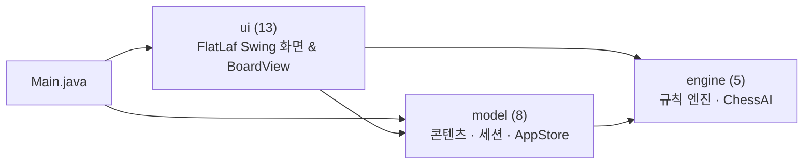

# ChessMate

Java 25 + Swing(FlatLaf) 기반 체스 학습·대전 데스크톱 애플리케이션입니다.  
**3개 핵심 패키지(`engine`, `model`, `ui`) · 27개 Java 클래스**로 단순하고 직관적인 구조를 유지하며, 외부 체스 엔진이나 DB 없이 순수 Java 체스 규칙·AI 엔진과 평문 `.txt` 저장소로 동작합니다.

## 주요 기능

| 화면 | 설명 |
| --- | --- |
| **홈** | 활성 프로필 요약(총점·레슨·퍼즐·AI 전적), 미완료 학습 자동 추천, 4개 모드 바로가기 |
| **레슨** | **기본 튜토리얼 8종**(폰~체크메이트·캐슬링·앙파상) + **유명 오프닝 6종**(이탈리안·루이 로페즈·퀸즈 갬빗·런던·시실리안·프렌치) 실습 |
| **퍼즐** | **자유 메이트 퍼즐**(N수 이내 어떤 수순으로든 체크메이트 + AI 동적 방어 + 무르기) + **전술 퍼즐**(포크·핀·스큐어·디스커버드·프로모션) 총 16문제 |
| **AI 대전** | 자체 구현 알파-베타·PST AI 4단계(입문/초급/중급/상급), 비동기 탐색, 추천 수 힌트, 2수 무르기, 전적 자동 기록 |
| **로컬 대전** | 한 화면 2인 대전, 설정 연동 자동 보드 뒤집기, 무르기, 기권, 전체 공식 무승부 규칙 적용 |
| **프로필** | 다중 프로필 생성·전환·삭제, 종합 점수(`레슨×10 + 퍼즐×5 + AI승×3`), 난이도별 AI 전적표 |
| **설정** | 보드 테마 3종(월넛·그린·슬레이트), 좌표·합법 수·직전 수·**호버 수 평가 미리보기**·로컬 자동 뒤집기 토글 |
| **호버 수 평가** | 기물 선택 후 이동 칸에 마우스를 올리면 고스트 기물, 내 공격·포크·체크, 아군 수비선, 방어 이탈 경고, **상대 예상 최선 응수 화살표**, 1줄 판정 바를 실시간 표시 |

## 패키지 구조

```text
app/src/main/java/com/oopteama/chess/
├── Main.java        진입점 (AppStore 로드 → FlatLaf 테마 설치 → MainWindow 실행)
├── engine/ (5)      순수 체스 규칙·SAN/FEN/UCI·AI 탐색·수 평가 (Swing/AWT 비의존)
├── model/  (8)      레슨/퍼즐/훈련 세션·프로필·설정·단일 파일 저장소 (Swing/AWT 비의존)
└── ui/    (13)      FlatLaf 3.7.2 기반 단일 창(MainWindow) · 공용 BoardView · 7개 화면
```



## 실행 및 테스트

요구 환경: **Java 25** (Gradle Wrapper 포함)

```sh
./gradlew :app:run      # 앱 실행
./gradlew :app:test     # 전체 단위/UI 스모크 테스트 실행 (14개)
./gradlew :app:jar      # 단일 실행 JAR 생성 (app/build/libs/chess-trainer.jar)
java -jar app/build/libs/chess-trainer.jar
```

사용자 데이터는 `~/.chessmate/`(`profiles.txt`, `settings.txt`)에 자동 저장되며, `-Dchessmate.home=/원하는/경로`로 변경할 수 있습니다.

## 구조 문서 (`docs/`)

- [전체 아키텍처 & 시각화](docs/architecture.md) — 계층 의존도, OOP 클래스 다이어그램, 핵심 로직 흐름, 데이터 포맷
- [Engine 패키지 상세](docs/engine.md) — `Piece`, `Move`, `Board`, `ChessGame`, `ChessAI`의 필드·함수·알고리즘
- [Model 패키지 상세](docs/model.md) — `Lesson`, `Puzzle`, `TrainingSession`, `Profile`, `Settings`, `AppStore`
- [UI 패키지 상세](docs/ui.md) — `Theme`, `MainWindow`, `BoardView` 렌더링 파이프라인, 7개 화면 구조
