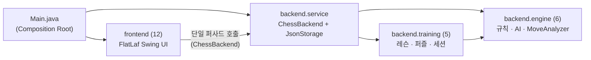

# ChessMate

Java 25 + Swing(**FlatLaf 3.7.2**) + **Gson JSON** 기반 체스 학습·대전 데스크톱 애플리케이션입니다.  
**`backend`와 `frontend`를 엄격히 분리**하고 SOLID 원칙을 준수하며, 총 **29개 Java 클래스**로 직관적인 구조를 유지합니다.

## 주요 기능

| 화면 | 설명 |
| --- | --- |
| **홈** | 활성 프로필 요약(총점·레슨·퍼즐·AI 전적), 미완료 학습 자동 추천, 4개 모드 바로가기 |
| **레슨** | `lessons.json` 기반 **기본 튜토리얼 8종** + **유명 오프닝 6종**(이탈리안·루이 로페즈·퀸즈 갬빗·런던·시실리안·프렌치) 실습 |
| **퍼즐** | `puzzles.json` 기반 **자유 메이트 퍼즐**(N수 이내 자율 수순 체크메이트 + AI 동적 방어 + 무르기) + **전술 퍼즐** 총 16문제 |
| **AI 대전** | 자체 구현 알파-베타·PST AI 4단계(입문/초급/중급/상급), 비동기 탐색, 추천 힌트, 2수 무르기, 전적 자동 기록 |
| **로컬 대전** | 한 화면 2인 대전, 설정 연동 자동 보드 뒤집기, 무르기, 기권, 전체 공식 무승부 규칙 적용 |
| **프로필** | 다중 프로필 생성·전환·삭제, 종합 점수(`레슨×10 + 퍼즐×5 + AI승×3`), 난이도별 AI 전적표 |
| **설정** | 보드 테마 3종(월넛·그린·슬레이트), 좌표·합법 수·직전 수·**호버 수 평가 미리보기**·로컬 자동 뒤집기 토글 |
| **호버 수 평가** | 기물 선택 후 이동 칸에 호버하면 고스트 기물, 내 공격·포크·체크, 아군 수비선, 방어 이탈 경고, **상대 예상 최선 응수 화살표**, 1줄 평가 바 표시 |

## 패키지 구조 (`backend` / `frontend` 엄격 분리)

```text
app/src/main/java/com/oopteama/chess/
├── Main.java                 조립 루트 (JsonStorage → ChessBackend → FlatLaf → MainWindow)
├── backend/                  순수 Java 도메인 & JSON 영속 계층 (AWT/Swing import 0개)
│   ├── engine/   (6)         Piece, Move, Board, ChessGame, ChessAI, MoveAnalyzer
│   ├── training/ (5)         Lesson, Puzzle, TrainingSession, LessonSession, PuzzleSession
│   └── service/  (5)         Profile, Settings, Storage(인터페이스), JsonStorage(Gson), ChessBackend(단일 퍼사드)
└── frontend/    (12)         FlatLaf Swing UI (파일 I/O · AI 직접 생성 0개, ChessBackend만 호출)
                              Theme, Screen(+Id), BoardView, MainWindow, 7개 화면, AbstractGamePanel
```



## 실행 및 테스트

요구 환경: **Java 25** (Gradle Wrapper 포함)

```sh
./gradlew :app:run      # 앱 실행
./gradlew :app:test     # 전체 단위 · DIP · UI 스모크 테스트 실행
./gradlew :app:jar      # 단일 실행 JAR 생성 (app/build/libs/chess-trainer.jar)
java -jar app/build/libs/chess-trainer.jar
```

사용자 데이터는 `~/.chessmate/userdata.json`에 Gson Pretty JSON으로 자동 저장되며, `-Dchessmate.home=/원하는/경로`로 변경할 수 있습니다.

## 구조 문서 (`docs/`)

- [전체 아키텍처 & SOLID 설계](docs/architecture.md) — 백엔드/프론트엔드 경계, SOLID 적용표, 클래스/시퀀스 다이어그램, JSON 스키마
- [Backend 패키지 상세](docs/backend.md) — `engine` · `training` · `service` 16개 클래스의 필드·메서드·알고리즘·JSON 직렬화
- [Frontend 패키지 상세](docs/frontend.md) — `Main` · `Theme` · `MainWindow` · `BoardView` 렌더링 파이프라인 · 7개 화면
