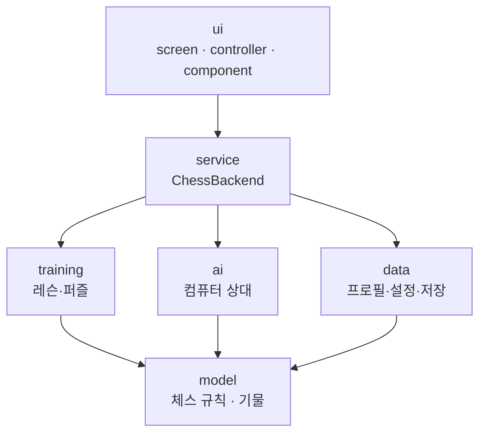

# ChessMate

체스 규칙을 배우고(레슨), 문제를 풀고(퍼즐), 컴퓨터나 친구와 두는(대전) Java 데스크톱 프로그램입니다.
객체 지향 프로그래밍 수업 팀 프로젝트로, **기물 클래스 상속**과 **화면(View)·컨트롤러 분리**를 중심으로 설계했습니다.

| 구분 | 사용 기술 |
| --- | --- |
| 언어 | Java 25 |
| 화면 | Swing + FlatLaf 3.7.2, Pretendard 글꼴 |
| 저장 | Gson 2.13.1 (JSON 파일) |
| 테스트 | JUnit 6.0.1 |

## 주요 기능

| 화면 | 할 수 있는 것 |
| --- | --- |
| 홈 | 점수와 진도 요약, 다음에 할 학습 추천, 각 모드 바로가기 |
| 레슨 | 기본 튜토리얼 8개(기물 이동부터 체크메이트까지)와 유명 오프닝 6개를 직접 두며 익히기 |
| 퍼즐 | N수 메이트 10문제(어떤 수순이든 메이트하면 정답, 상대는 최선으로 방어)와 전술 6문제. 힌트·무르기 지원 |
| AI 대전 | 입문·초급·중급·상급 4단계(1~4수 앞까지 계산), 힌트, 무르기, 기권, 전적 자동 기록 |
| 로컬 대전 | 한 컴퓨터에서 둘이 번갈아 두기, 차례마다 보드 자동 뒤집기(설정) |
| 프로필 | 여러 사용자, 점수(레슨 완료×10 + 퍼즐 해결×5 + AI 승리×3), 난이도별 전적 |
| 설정 | 체스판 테마 3종, 좌표·이동 가능 칸·직전 수 표시, 수 설명 켜기/끄기, 로컬 대전 자동 뒤집기 |
| 수 설명 | 퍼즐·AI 대전·로컬 대전에서 기물을 고른 뒤 갈 수 있는 칸에 마우스를 올리면, 그 수가 최선·좋은·아쉬운·나쁜 수인지와 이유(잡기, 잡힐 위험, 포크, 상대의 예상 응수 등)를 화살표·빛나는 칸·기물 미리보기·설명 카드 애니메이션으로 보여 줌 |

체스 규칙은 캐슬링, 앙파상, 승진, 체크메이트, 스테일메이트, 50수 규칙, 3회 반복, 기물 부족 무승부까지 구현했습니다.

## 패키지 구조

```text
app/src/main/java/com/oopteama/chess/
├── Main.java        프로그램 시작: 저장소 → ChessBackend → 메인 창 순서로 조립
├── model/           체스 규칙: Board, Position, Move, Rules, Game, Fen, Notation …
│   └── piece/       기물 클래스 계층: Piece ← King, Queen, Rook, Bishop, Knight, Pawn
├── ai/              컴퓨터 상대(미니맥스), N수 메이트 계산, 수 설명(MoveAdvisor)
├── training/        레슨·퍼즐 채점: TrainingSession ← LessonSession, PuzzleSession
├── data/            프로필·설정과 JSON 저장: Storage(인터페이스) ← JsonStorage
├── service/         ChessBackend: 화면이 기능을 쓸 때 거치는 단일 창구
└── ui/              Swing 화면: MainFrame(메인 창), Theme(색·글꼴)
    ├── screen/      화면(View): 보여 주기만 함
    ├── controller/  컨트롤러: 버튼·마우스 이벤트를 받아 처리
    └── component/   여러 화면이 같이 쓰는 부품: BoardPanel(체스판) …
```



지킨 규칙은 세 가지입니다.

1. **아래 계층은 위 계층을 모릅니다.** 예를 들어 `model`은 화면이나 저장 코드를 전혀 import하지 않습니다.
2. **Swing은 `ui`에서만, Gson과 파일 읽기·쓰기는 `data`에서만** 씁니다. `model`·`ai`·`training`·`service`는 `java.util`만 씁니다.
3. **화면(`ui.screen`)은 보여 주기만 합니다.** 버튼을 눌렀을 때의 처리와 `ChessBackend` 호출은 컨트롤러(`ui.controller`)가 맡습니다.

## 실행과 테스트

Java 25가 필요합니다 (Gradle Wrapper 포함).

```bash
./gradlew :app:run     # 프로그램 실행
./gradlew :app:test    # 전체 테스트 (화면 테스트도 창을 띄우지 않음)
./gradlew :app:jar     # 실행 파일 만들기: app/build/libs/chess-trainer.jar
java -jar app/build/libs/chess-trainer.jar
```

사용자 데이터(프로필·설정)는 `~/.chessmate/userdata.json`에 저장됩니다. 실행 옵션 `-Dchessmate.home=경로`로 저장 위치를 바꿀 수 있습니다.

## 문서

- [전체 구조](docs/architecture.md): 계층, 객체 지향 개념이 쓰인 곳, 클래스·시퀀스 다이어그램, 저장 형식, 리팩터링 전후 비교
- [백엔드](docs/backend.md): `model`·`ai`·`training`·`data`·`service` 패키지의 클래스와 알고리즘
- [화면](docs/frontend.md): `ui` 패키지의 화면·컨트롤러·부품, 새 화면을 추가하는 방법
- [학습 가이드 PDF](docs/learning-guide.pdf) · [HTML](docs/learning-guide.html): 발표 준비용 자료. 개념 설명, UML·시퀀스 다이어그램, 핵심 로직, 클래스 사전, 점검 질문 12개를 담았습니다. HTML은 내려받아 브라우저로 열면 기물 이동 예시를 직접 눌러 볼 수 있습니다.
