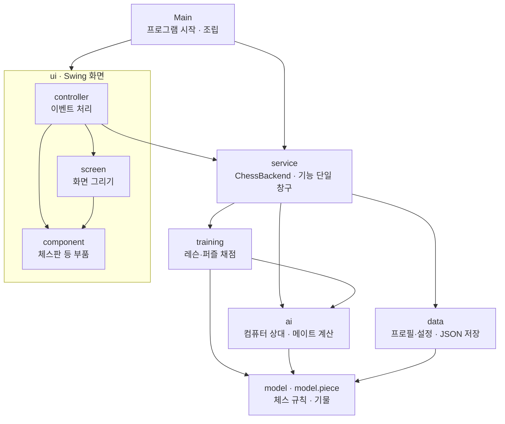
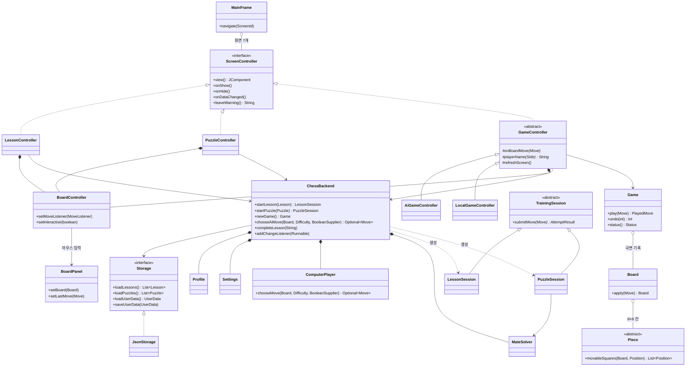
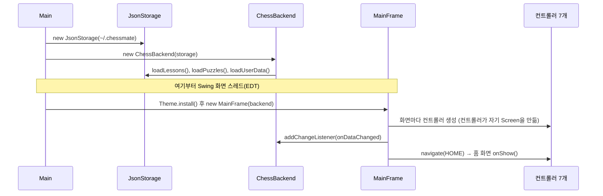
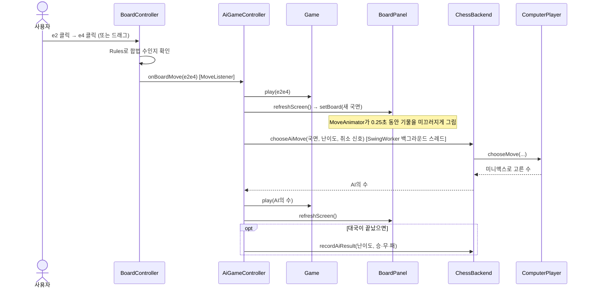
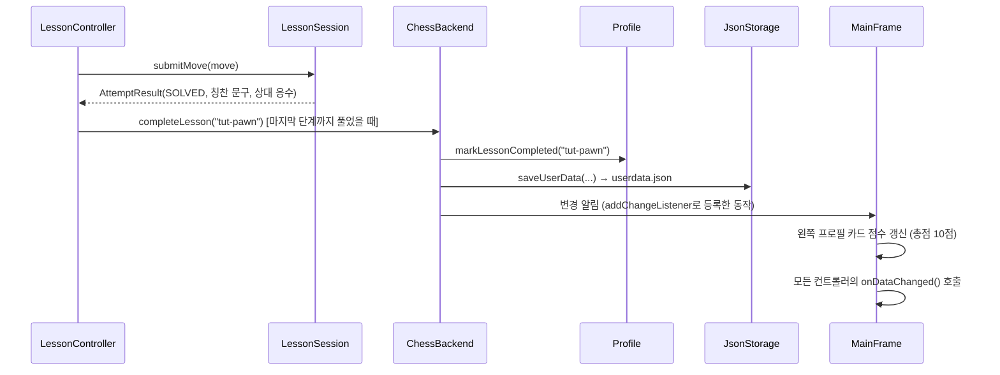
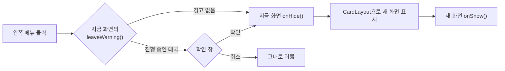

# 전체 구조

ChessMate는 **계층(layer)** 으로 나뉜 프로그램입니다. 위 계층은 아래 계층을 사용하고, 아래 계층은 위 계층을 모릅니다.
이 문서는 전체 그림을 설명하고, 패키지별 자세한 내용은 [백엔드](backend.md)와 [화면](frontend.md) 문서에 있습니다.

## 1. 계층과 패키지

| 패키지 | 파일 | 하는 일 | 쓰는 외부 라이브러리 |
| --- | --- | --- | --- |
| `model` | 9 | 체스판, 칸, 수, 규칙 판정, 대국 기록, FEN·기보 표기 | 없음 (`java.util`만) |
| `model.piece` | 9 | 기물 클래스 계층 (`Piece`와 6종류 기물) | 없음 |
| `ai` | 4 | 컴퓨터 상대(미니맥스), 국면 점수, N수 메이트 계산 | 없음 |
| `training` | 6 | 레슨·퍼즐 데이터와 채점 | 없음 |
| `data` | 4 | 프로필·설정, JSON 파일 읽기·쓰기 | Gson, `java.nio.file` |
| `service` | 1 | `ChessBackend`: 화면이 기능을 쓸 때 거치는 단일 창구 | 없음 |
| `ui` | 3 | `MainFrame`(메인 창), `ScreenId`(화면 목록), `Theme`(색·글꼴·버튼 모양) | Swing, FlatLaf |
| `ui.screen` | 8 | 화면(View): 컴포넌트 배치와 보여 주기 | Swing |
| `ui.controller` | 10 | 컨트롤러: 버튼·마우스 이벤트를 받아 처리 | Swing |
| `ui.component` | 6 | 여러 화면이 같이 쓰는 부품 (체스판, 기물 그림, 애니메이션 …) | Swing |
| (최상위) | 1 | `Main`: 객체를 만들어 연결하고 창을 띄움 | Swing |

지킨 규칙:

- **아래 계층은 위 계층을 import하지 않습니다.** `model`은 다른 패키지를 쓰지 않고, `service` 아래는 Swing을 모릅니다.
- **Swing은 `ui`에서만, Gson과 파일 입출력은 `data`에서만** 씁니다. 저장 방식을 바꿔도 `data`만 고치면 됩니다.
- **`ui.screen`과 `ui.component`는 `ChessBackend`를 호출하지 않습니다.** 화면은 `Board`, `Lesson` 같은 값을 받아 보여 주기만 하고, 기능 호출은 `ui.controller`만 합니다.

## 2. 객체 지향 개념이 쓰인 곳

| 개념 | 어디에 | 발표 때 보여 줄 부분 |
| --- | --- | --- |
| 상속 | `Piece` ← `SlidingPiece`(`Queen`·`Rook`·`Bishop`), `StepPiece`(`King`·`Knight`), `Pawn` | [`Rook`](../app/src/main/java/com/oopteama/chess/model/piece/Rook.java)은 방향 4개만 정하고, 실제 이동 계산은 부모 [`SlidingPiece`](../app/src/main/java/com/oopteama/chess/model/piece/SlidingPiece.java)가 합니다 |
| | `TrainingSession` ← `LessonSession`, `PuzzleSession` | 피드백·힌트·상대 응수는 부모가, 채점(`submitMove`)은 자식이 각자 구현 |
| | `GameController` ← `AiGameController`, `LocalGameController` `GameScreen` ← `AiGameScreen`, `LocalGameScreen` | 체스판·기보·선수 표시는 부모가, 버튼과 상대(AI·사람)는 자식이 담당 |
| 다형성 | [`Rules.candidateMoves()`](../app/src/main/java/com/oopteama/chess/model/Rules.java) | 기물마다 다른 이동 규칙을 `piece.movableSquares(board, from)` 한 줄로 구합니다. 기물 종류를 묻는 `instanceof`는 판 전체를 봐야 하는 승진·캐슬링에만 씁니다 |
| | [`MainFrame.navigate()`](../app/src/main/java/com/oopteama/chess/ui/MainFrame.java) | 화면 7개를 `ScreenController` 타입 하나로 다루며 `onShow()`·`onHide()`를 부릅니다 |
| 추상 클래스 | `Piece`, `SlidingPiece`, `StepPiece`, `TrainingSession`, `GameController` | 공통 코드는 부모에 두고, 달라지는 부분만 `abstract` 메서드로 남겼습니다 |
| 인터페이스 | `Storage`, `ScreenController`, `BoardController.MoveListener` | "무엇을 해야 하는지"만 정하고 구현은 갈아 끼울 수 있게 합니다 |
| 캡슐화 | [`Board`](../app/src/main/java/com/oopteama/chess/model/Board.java): 필드가 모두 `private final`, setter 없음 [`Profile`](../app/src/main/java/com/oopteama/chess/data/Profile.java): 기록은 `recordPuzzle()` 같은 메서드로만 바뀜 | `board.apply(move)`는 원래 판을 바꾸지 않고 **새 `Board`** 를 돌려줍니다 (불변 객체) |
| 의존성 역전 (DIP) | [`ChessBackend(Storage storage)`](../app/src/main/java/com/oopteama/chess/service/ChessBackend.java) | `ChessBackend`는 `JsonStorage`를 모르고 `Storage` 인터페이스만 압니다. 테스트에서는 메모리에 저장하는 구현을 넣습니다 |
| 정적 팩토리 메서드 | `Piece.create('Q', side)`, `Board.fromFen(...)`, `Position.of("e4")`, `Move.of("e2e4")` | 객체를 만드는 규칙을 클래스 안에 숨깁니다 |
| record · enum | record: `Position`, `Move`, `Lesson`, `Puzzle`, `AttemptResult` … enum: `Side`, `Difficulty`, `Game.Status`, `ScreenId` … | 값만 담는 클래스를 짧고 안전하게 씁니다 |

### 디자인 패턴

| 패턴 | 클래스 | 이 프로젝트에서 |
| --- | --- | --- |
| MVC | `ui.screen`(View), `ui.controller`(Controller), `model`·`training`·`service`(Model) | 화면은 그리기만, 컨트롤러가 이벤트를 받아 모델을 바꾸고 결과를 화면에 넘깁니다 |
| 퍼사드 (Facade) | `ChessBackend` | 화면은 레슨·퍼즐·AI·프로필·저장 기능을 이 클래스 하나로만 씁니다 |
| 옵저버 (Observer) | `ChessBackend.addChangeListener()` `BoardController.MoveListener` | 데이터가 바뀌면 등록된 메인 창에 알리고, 메인 창이 모든 화면을 새로 고칩니다 체스판에서 수를 두면 그 화면의 컨트롤러에 알립니다 |
| 템플릿 메서드 | `Piece.movableSquares()`, `SlidingPiece.attackedSquares()`, `GameController.refreshScreen()` | 순서(뼈대)는 부모가 정하고, 빈칸(`attackedSquares`, `directions`, `playerName`)은 자식이 채웁니다 |

## 3. 핵심 클래스 다이어그램

계층을 넘나드는 관계만 그렸습니다. 패키지 안쪽 클래스는 [백엔드](backend.md)와 [화면](frontend.md) 문서에 따로 있습니다.

화살표 읽는 법: `<|--` 상속, `<|..` 인터페이스 구현, `*--` 포함(만들어서 가짐), `o--` 모음(가지고 있음), `-->` 사용, `..>` 잠깐 사용(생성 등).

## 4. 실행 흐름

### A. 프로그램 시작

### B. AI 대전에서 한 수 두기

AI 계산은 백그라운드 스레드에서 하므로 그동안에도 화면이 멈추지 않습니다. 새 대국을 시작하거나 화면을 떠나면 취소 신호로 계산을 멈추고, 다시 돌아오면 AI 차례를 이어서 둡니다.

### C. 레슨을 끝내면 저장하고 모든 화면을 새로 고치기

### D. 화면 전환

## 5. 저장 형식 (JSON)

| 파일 | 위치 | 구조 |
| --- | --- | --- |
| `lessons.json` | `app/src/main/resources/data/` | `[{ id, category, title, summary, side, setup[], steps: [{ fen, sandbox, goal, hints[], prompt, success, reply }] }]` |
| `puzzles.json` | `app/src/main/resources/data/` | `[{ id, theme, mate, title, fen, solution[], explain }]` |
| `userdata.json` | `~/.chessmate/` (`-Dchessmate.home`로 변경) | `{ activeProfileId, settings: { boardTheme, showCoords, showLegalMoves, highlightLastMove, autoFlipLocal }, profiles: [{ id, name, completedLessons[], puzzleStats{}, aiRecords{} }] }` |

- 레슨 단계의 `goal`: `any`(아무 수), `check`(체크하는 수), `mate`(메이트하는 수), 또는 `e2e3,e2e4`처럼 정답 수 목록입니다.
- 오프닝 레슨은 `setup`의 수를 처음 국면에서 차례로 둔 뒤 시작하고, `fen`이 `continue`인 단계는 앞 단계의 정답과 상대 응수(`reply`)를 둔 국면에서 이어집니다.
- `puzzleStats`는 퍼즐마다 `[시도 횟수, 정답 횟수]`, `aiRecords`는 난이도마다 `[승, 무, 패]`입니다.
- 리팩터링 전 버전이 저장한 `userdata.json`도 그대로 읽습니다. 없어진 설정 항목(`showMovePreview`)은 무시합니다.

## 6. 코드 읽는 순서 (추천)

1. [`model/piece/Piece.java`](../app/src/main/java/com/oopteama/chess/model/piece/Piece.java) → [`SlidingPiece`](../app/src/main/java/com/oopteama/chess/model/piece/SlidingPiece.java) → [`Rook`](../app/src/main/java/com/oopteama/chess/model/piece/Rook.java) → [`Pawn`](../app/src/main/java/com/oopteama/chess/model/piece/Pawn.java): 상속과 다형성
2. [`model/Board.java`](../app/src/main/java/com/oopteama/chess/model/Board.java) → [`Rules.java`](../app/src/main/java/com/oopteama/chess/model/Rules.java) → [`Game.java`](../app/src/main/java/com/oopteama/chess/model/Game.java): 체스판, 합법 수, 대국 기록
3. [`ai/ComputerPlayer.java`](../app/src/main/java/com/oopteama/chess/ai/ComputerPlayer.java): 미니맥스와 알파-베타 가지치기
4. [`training/TrainingSession.java`](../app/src/main/java/com/oopteama/chess/training/TrainingSession.java) → [`LessonSession`](../app/src/main/java/com/oopteama/chess/training/LessonSession.java): 추상 클래스와 채점
5. [`service/ChessBackend.java`](../app/src/main/java/com/oopteama/chess/service/ChessBackend.java) → [`data/Storage.java`](../app/src/main/java/com/oopteama/chess/data/Storage.java): 퍼사드, 옵저버, 인터페이스
6. [`ui/MainFrame.java`](../app/src/main/java/com/oopteama/chess/ui/MainFrame.java) → [`SettingsController`](../app/src/main/java/com/oopteama/chess/ui/controller/SettingsController.java)와 [`SettingsScreen`](../app/src/main/java/com/oopteama/chess/ui/screen/SettingsScreen.java): 가장 짧은 MVC 예시
7. [`ui/controller/BoardController.java`](../app/src/main/java/com/oopteama/chess/ui/controller/BoardController.java) → [`ui/component/BoardPanel.java`](../app/src/main/java/com/oopteama/chess/ui/component/BoardPanel.java): 체스판 입력과 그리기

## 7. 리팩터링 전후 비교 (2026-11-25)

발표 준비를 위해 구조를 학부 수준에서 이해하기 쉽게 다시 짰습니다. 저장 형식과 대부분의 기능은 그대로 두고(아래 "바뀐 동작" 참고), 한 파일이 한 가지 일만 하도록 나눴습니다. 전체 코드 양은 비슷하지만 파일 하나의 크기가 절반으로 줄었습니다.

| | 전 (#40 병합 시점) | 후 |
| --- | --- | --- |
| Java 파일 (main) | 31개 | 61개 |
| 전체 줄 수 (main) | 7,471줄 | 7,572줄 |
| 파일당 평균 | 241줄 | 124줄 |
| 가장 큰 파일 | `BoardView.java` 1,120줄 | `BoardPanel.java` 424줄 |
| 테스트 | 7개 파일 | 9개 파일, 테스트 29개 |

| 전 | 후 |
| --- | --- |
| `backend/engine/Piece` (enum 하나에 모든 기물) | `model/piece/` 기물 클래스 9개 (상속 계층) |
| `backend/engine/Board` (802줄, 규칙까지 포함) | `model/Board`, `Position`, `Move`, `CastlingRights`, `Fen`, `Rules`, `Notation` |
| `backend/engine/ChessGame` | `model/Game` |
| `backend/engine/ChessAI` (탐색과 메이트 계산을 한 클래스에) | `ai/ComputerPlayer`, `MateSolver`, `Evaluator`, `Difficulty` |
| `backend/engine/MoveAnalyzer` (마우스를 올린 수 평가) | 삭제 (기능 제거) |
| `backend/training/*` | `training/*` (`LessonStep`을 별도 클래스로) |
| `backend/service/Profile`, `Settings`, `Storage`, `JsonStorage` | `data/*` |
| `backend/service/ChessBackend` | `service/ChessBackend` |
| `frontend/MainWindow`, `Screen` | `ui/MainFrame`, `ui/ScreenId`, `ui/controller/ScreenController` |
| `frontend/BoardView` (그리기 + 입력 + 애니메이션) | `ui/component/BoardPanel`(그리기), `PiecePainter`, `MoveAnimator` + `ui/controller/BoardController`(입력) |
| `frontend/*Panel` (화면과 이벤트 처리를 한 클래스에) | `ui/screen/*Screen`(화면) + `ui/controller/*Controller`(이벤트 처리) |
| `frontend/RetryCard` | `ui/component/RetryDialog` |

바뀐 동작:

- **마우스를 올린 칸의 수 평가 미리보기**(설정의 "이동 칸 호버 시 수 평가 및 이후 전개 미리보기" 항목 포함)를 없앴습니다. 코드가 가장 복잡했던 부분입니다.
- **AI**는 반복 심화·네가맥스 대신 기본 미니맥스 + 알파-베타 가지치기로 바꾸고, 난이도를 탐색 깊이(1~4수)로 정했습니다.
- **고친 문제**: AI 대전에서 AI가 생각하는 동안 다른 화면에 갔다 오면 AI가 다시 두지 않아 대국이 멈추던 문제를 고쳤습니다.
