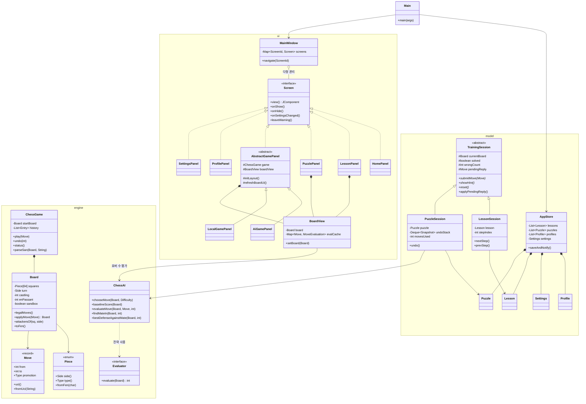
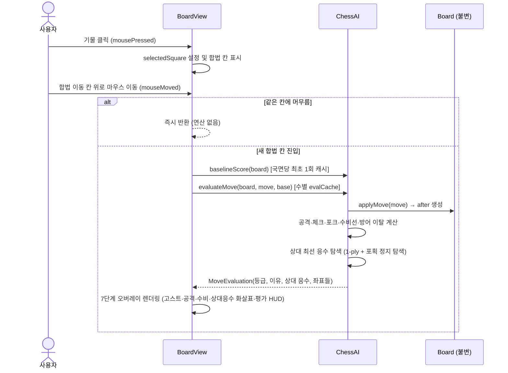
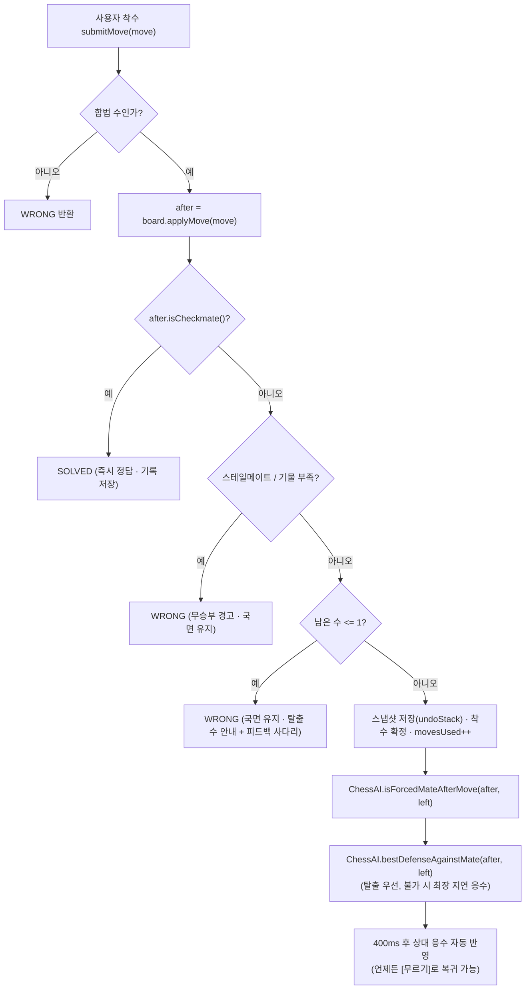
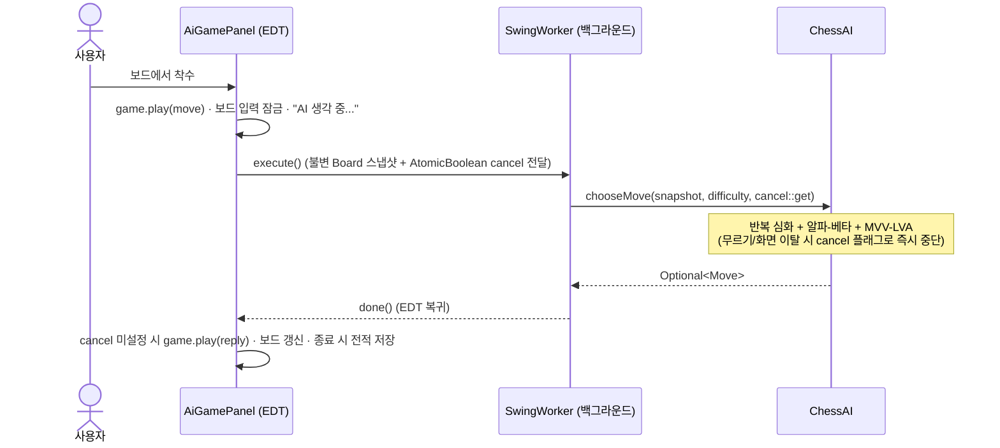

# ChessMate 아키텍처 개요

전체 코드는 **단방향 3계층(`ui → model → engine`)**으로 분리되어 있습니다.  
`engine`과 `model`은 AWT/Swing을 일절 참조하지 않아 JUnit만으로 규칙·AI·학습 세션·파일 저장을 독립 검증할 수 있습니다.

---

## 1. 전체 클래스 구조도 (OOP 관계)

### OOP 설계 포인트

| 개념 | 적용 위치 | 목적 |
| --- | --- | --- |
| **불변 객체 & 캡슐화** | `Board` | 64칸 배열을 외부에 노출하지 않고 착수마다 새 `Board` 반환 → AI 탐색·호버 프리뷰·무르기에서 부작용 원천 차단 |
| **인터페이스 · 다형성** | `Screen`, `ChessAI.Evaluator` | `MainWindow`가 7개 화면을 `Screen` 계약만으로 전환 / `ChessAI`가 난이도별 평가 전략(`MATERIAL`, `MATERIAL_PST`) 교체 |
| **상속 · 템플릿 메서드** | `TrainingSession` → `LessonSession` / `PuzzleSession` `AbstractGamePanel` → `AiGamePanel` / `LocalGamePanel` | 보드 훈련 공통 상태(피드백 사다리·자동 응수)와 대국 공통 UI(보드·기보·잡힌 기물) 중복 제거 |
| **관찰자 패턴** | `AppStore.addChangeListener(Runnable)` | 프로필 변경·점수 갱신·설정 변경 시 사이드바와 모든 화면에 즉시 전파 |

---

## 2. 핵심 로직 흐름 시각화

### A. 기물 선택 → 호버 시 수 평가 & 이후 전개 시각화

### B. 자유 메이트 퍼즐 (`mate=N`) 진행 흐름

### C. AI 대전 비동기 착수 흐름

---

## 3. 데이터 포맷 & 저장 구조

모든 번들 콘텐츠와 사용자 기록은 외부 라이브러리 없는 **UTF-8 평문 `.txt`** (`---` 블록 구분, `key=value`)로 통일했습니다.

| 경로 | 용도 | 포맷 요약 |
| --- | --- | --- |
| `app/src/main/resources/data/lessons.txt` | 기본 튜토리얼 8개 + 유명 오프닝 6개 | `id`, `category`, `title`, `summary`, `side`, `setup`, `step=fen\|mode\|goal\|hints\|prompt\|success[\|reply]` |
| `app/src/main/resources/data/puzzles.txt` | 자유 메이트 10개 + 전술 퍼즐 6개 | `id`, `theme`, `mate`, `title`, `fen`, `solution`, `explain` |
| `~/.chessmate/profiles.txt` | 다중 프로필 및 학습/AI 기록 | `active=<id>` + 프로필별 `id`, `name`, `lessons`, `puzzle.<id>=시도,해결`, `ai.<난이도>=승,무,패` |
| `~/.chessmate/settings.txt` | 보드 테마 및 표시 옵션 | `boardTheme`, `showCoords`, `showLegalMoves`, `highlightLastMove`, `showMovePreview`, `autoFlipLocal` |
