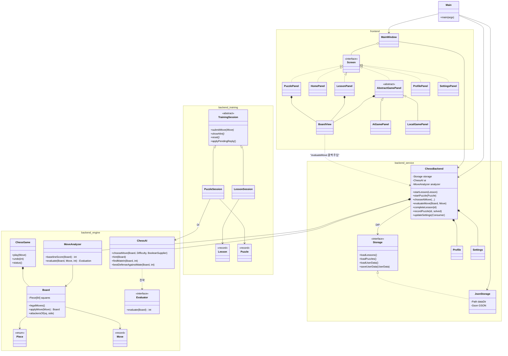
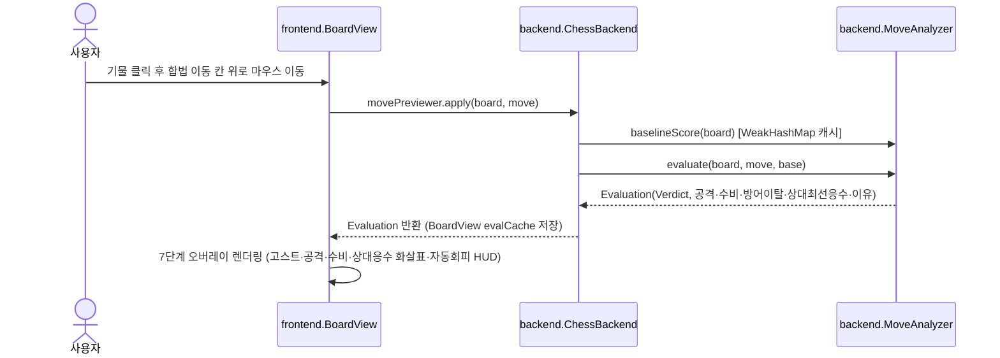
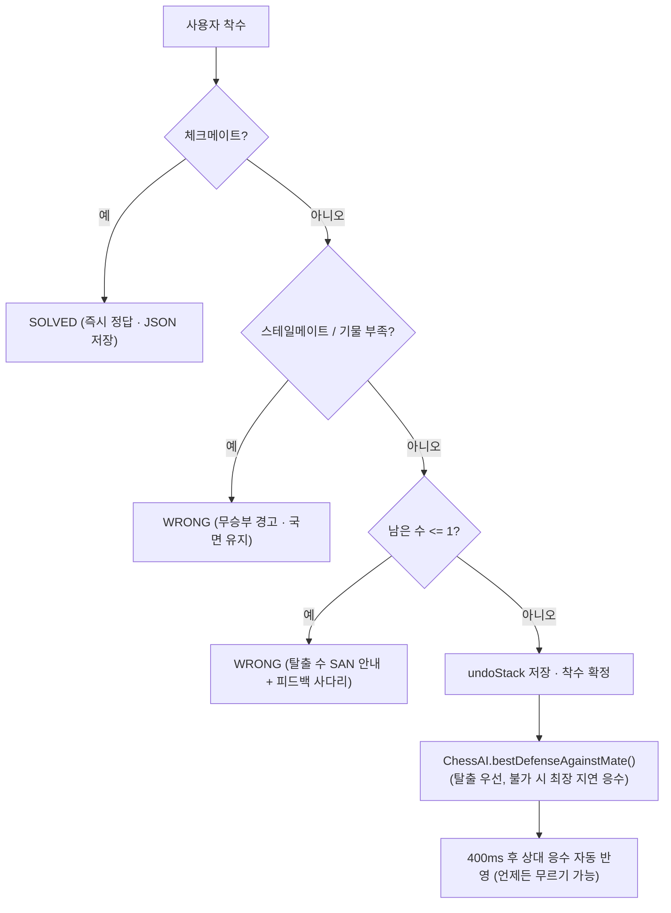

# ChessMate 아키텍처 & SOLID 설계

## 1. 엄격한 Backend / Frontend 분리 원칙

| 경계 규칙 | 보장 방식 |
| --- | --- |
| **Backend 순수성** | `backend/**` 전체에서 `java.awt.*`, `javax.swing.*`, `com.formdev.*`, `frontend.*` import **0개** |
| **Frontend 순수성** | `frontend/**` 전체에서 `com.google.gson.*`, `JsonStorage`, `java.nio.file.*`, `new ChessAI()`, `new MoveAnalyzer()`, `new LessonSession()`, `new PuzzleSession()` **0개** |
| **단일 진입점 퍼사드** | 모든 프론트엔드 화면은 **`ChessBackend`**를 통해서만 세션 생성, AI 탐색, 수 평가, 프로필/설정 변경 및 저장을 수행 |
| **단일 조립 루트** | **`Main.java`** 한 곳에서만 `new JsonStorage(...) → new ChessBackend(storage) → new MainWindow(backend)`를 조립 |

---

## 2. SOLID 원칙 준수 요약

| 원칙 | 적용 위치 | 구체적 설계 |
| --- | --- | --- |
| **S (SRP)** | `ChessAI` vs `MoveAnalyzer` `JsonStorage` vs `ChessBackend` `BoardView` | 대국 탐색·메이트 솔버(`ChessAI`)와 후보 수 평가(`MoveAnalyzer`) 분리 / JSON 직렬화(`JsonStorage`)와 앱 상태 관리(`ChessBackend`) 분리 / `BoardView`는 렌더링·입력만 담당 |
| **O (OCP)** | `Storage`, `ChessAI.Evaluator`, `TrainingSession`, `Screen` | 저장소 교체, 평가 함수 확장, 신규 훈련 모드·화면 추가 시 기존 조율 코드 수정 불필요 |
| **L (LSP)** | `LessonSession`/`PuzzleSession` ⊂ `TrainingSession` `AiGamePanel`/`LocalGamePanel` ⊂ `AbstractGamePanel` | 모든 하위 클래스가 상위 추상 계약(`submitMove`, `showHint`, `reset`, `Screen`)을 예외 없이 대체 가능 |
| **I (ISP)** | `BoardView(Settings, BiFunction<Board, Move, Evaluation>)` `Storage`, `Screen` | `BoardView`는 전체 `ChessBackend` 대신 필요한 설정과 수 평가 콜백만 의존 |
| **D (DIP)** | `ChessBackend(Storage)` `PuzzleSession(Puzzle, ChessAI)` `BoardView(..., movePreviewer)` | 상위 정책이 구체 구현(`JsonStorage`, `MoveAnalyzer`) 대신 추상 계약(`Storage`, 함수형 콜백)에 의존 |

---

## 3. 전체 클래스 다이어그램

---

## 4. 핵심 실행 흐름 시각화

### A. 호버 수 평가 & 이후 전개 시각화 (DIP 콜백 경유)

### B. 자유 메이트 퍼즐 (`mate=N`) 흐름

---

## 5. JSON 데이터 스키마 (`Gson` 직렬화)

| 파일 | 위치 | 구조 |
| --- | --- | --- |
| `lessons.json` | `app/src/main/resources/data/` | `[{ id, category, title, summary, side, setup?, steps: [{ fen, sandbox, goal, hints[], prompt, success, reply? }] }]` |
| `puzzles.json` | `app/src/main/resources/data/` | `[{ id, theme, mate, title, fen, solution[], explain }]` |
| `userdata.json` | `~/.chessmate/` (`-Dchessmate.home`) | `{ activeProfileId, settings: { boardTheme, showCoords, showLegalMoves, highlightLastMove, showMovePreview, autoFlipLocal }, profiles: [{ id, name, completedLessons[], puzzleStats{}, aiRecords{} }] }` |
