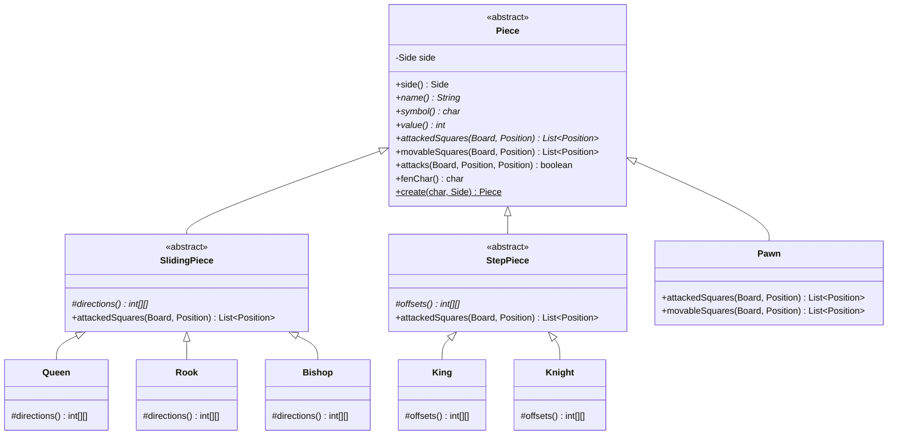
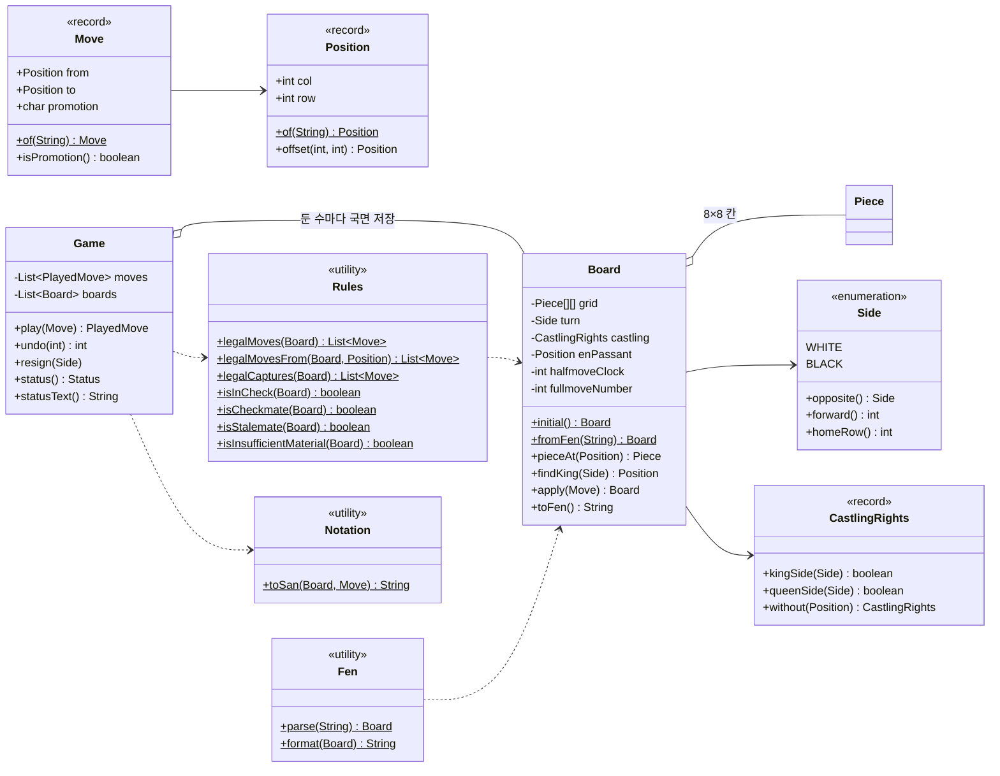
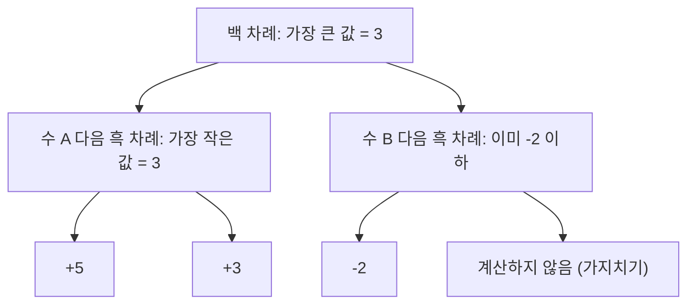
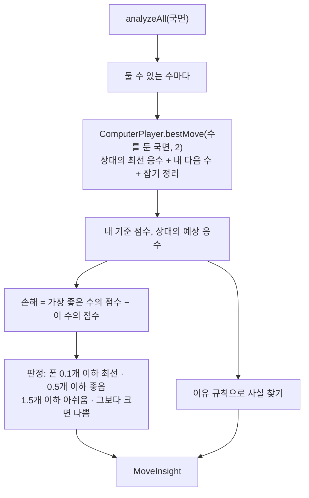
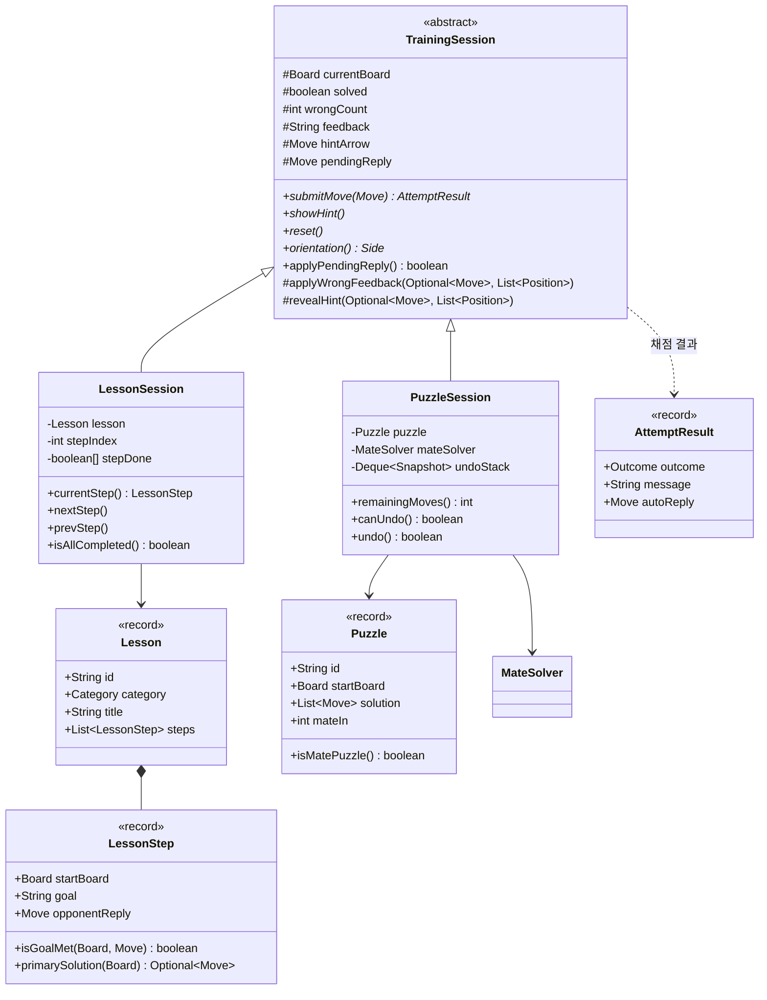
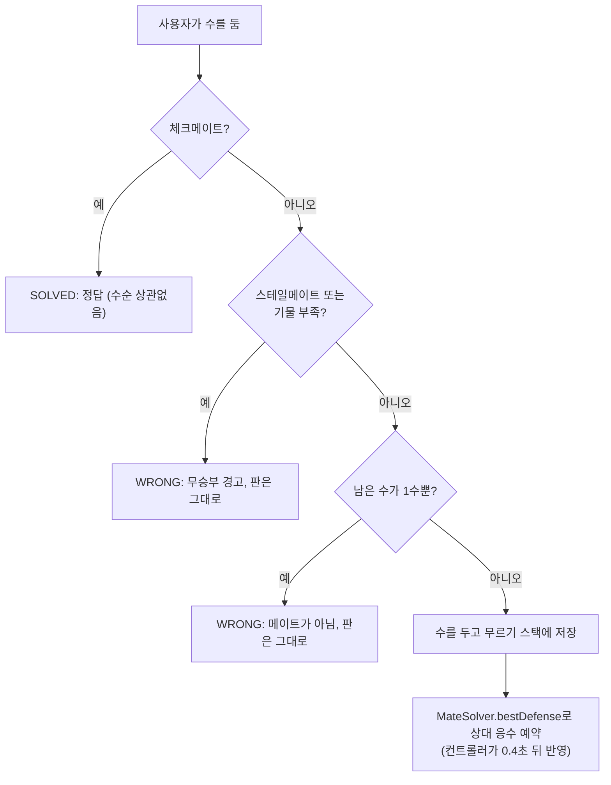
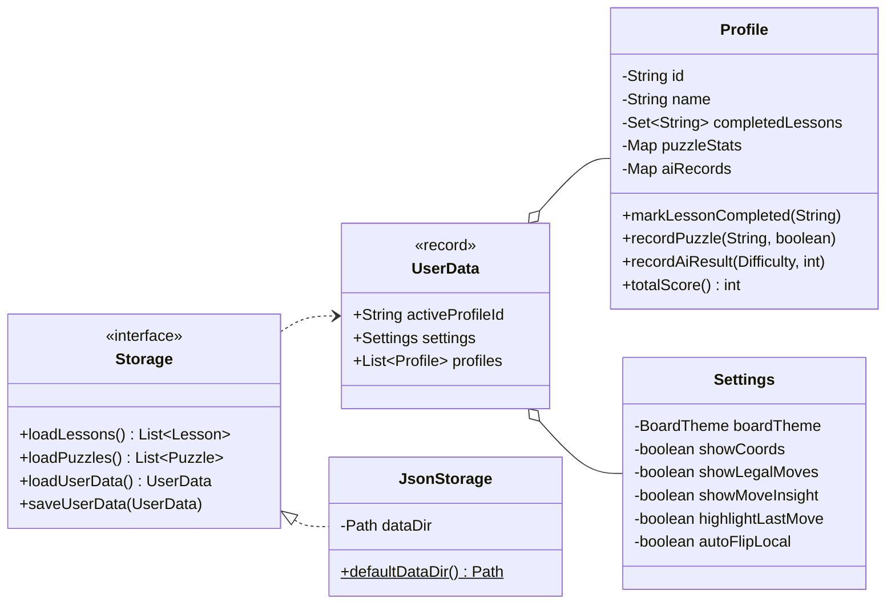

# 백엔드: model · ai · training · data · service

화면(Swing)과 상관없는 프로그램의 핵심입니다. 파일 저장을 맡은 `data`를 빼면 모두 `java.util`만 쓰기 때문에 화면 없이 테스트할 수 있습니다.
전체 그림은 [전체 구조](architecture.md)에 있습니다.

## 1. `model.piece`: 기물 클래스 계층



| 클래스 | 부모 | 움직이는 방법 | 가치 (AI 점수) |
| --- | --- | --- | --- |
| `Queen` | `SlidingPiece` | 가로·세로·대각선 8방향으로 막힐 때까지 | 900 |
| `Rook` | `SlidingPiece` | 가로·세로 4방향으로 막힐 때까지 | 500 |
| `Bishop` | `SlidingPiece` | 대각선 4방향으로 막힐 때까지 | 330 |
| `Knight` | `StepPiece` | L자 8칸 (다른 기물을 뛰어넘음) | 320 |
| `King` | `StepPiece` | 주변 8칸 (캐슬링은 `Rules`가 따로 추가) | 20,000 |
| `Pawn` | `Piece` | 앞으로 1칸(처음 자리에서는 2칸), 대각선 앞의 상대 잡기, 앙파상 | 100 |

**메서드 두 개를 나눈 이유**

- `attackedSquares()`: 이 기물이 **공격하는 칸**입니다. 킹이 공격받는지(체크) 판단할 때 씁니다.
- `movableSquares()`: 이 기물이 **갈 수 있는 칸**입니다. 부모 `Piece`의 기본 구현은 "공격하는 칸 중 아군이 없는 칸"입니다.
- 폰만 두 가지가 다릅니다(앞으로 가지만 대각선으로 잡음). 그래서 `Pawn`만 `movableSquares()`를 다시 정의(오버라이딩)합니다.

**하위 클래스가 얼마나 짧은지** — 룩은 방향 4개만 알려 주면 되고, 실제로 미끄러지며 칸을 모으는 코드는 부모 `SlidingPiece`에 한 번만 있습니다.

```java
public class Rook extends SlidingPiece {

    private static final int[][] DIRECTIONS = {{1, 0}, {-1, 0}, {0, 1}, {0, -1}};

    public Rook(Side side) {
        super(side);
    }

    @Override
    protected int[][] directions() {
        return DIRECTIONS;
    }

    @Override
    public String name() {
        return "룩";
    }

    @Override
    public char symbol() {
        return 'R';
    }

    @Override
    public int value() {
        return 500;
    }
}
```

`Piece.create('Q', Side.WHITE)`는 기호를 보고 알맞은 하위 클래스 객체를 만들어 주는 정적 팩토리 메서드입니다. 폰 승진과 FEN 읽기에서 씁니다.

## 2. `model`: 체스판과 규칙



| 클래스 | 종류 | 하는 일 |
| --- | --- | --- |
| `Side` | enum | 백·흑. `opposite()`(상대), `forward()`(폰 전진 방향 +1/−1), `homeRow()`(첫 줄) |
| `Position` | record | 칸 하나. `col` 0~7 = a~h, `row` 0~7 = 1~8. `Position.of("e4")`, `offset(열, 행)`(판 밖이면 `null`) |
| `Move` | record | 수 하나: 출발 칸, 도착 칸, 승진 기물. `Move.of("e2e4")`, `Move.of("b7b8q")` |
| `CastlingRights` | record | 백·흑의 킹 쪽·퀸 쪽 캐슬링 가능 여부 4개 |
| `Board` | 불변 클래스 | 8×8 칸, 차례, 캐슬링 권리, 앙파상 칸, 50수 카운터, 수 번호. `apply(move)`는 **새 `Board`** 를 돌려줌 |
| `Fen` | 유틸리티 | FEN 문자열 ↔ `Board`. 킹 개수, 1·8랭크의 폰 같은 잘못된 국면을 검사 |
| `Rules` | 유틸리티 | 합법 수, 체크·체크메이트·스테일메이트·기물 부족, 캐슬링·앙파상 판별 |
| `Notation` | 유틸리티 | 기보 표기(SAN): `Nf3`, `exd6`, `O-O`, `b8=Q+`, `Qxf7#` |
| `Game` | 클래스 | 대국 기록: 둔 수(`PlayedMove`)와 국면 목록, 무르기, 기권, 결과(`Status`) 판정, 잡은 기물 |

### 합법 수를 구하는 3단계 (`Rules.legalMoves`)

1. **기물 규칙**: 차례인 쪽의 기물마다 `piece.movableSquares(board, from)`를 부릅니다. 기물 종류는 신경 쓰지 않습니다(다형성).
2. **판 전체 규칙**: 끝 줄에 닿은 폰은 퀸·룩·비숍·나이트 승진 4가지 수로 늘리고, 킹에는 캐슬링 수를 더합니다. 킹을 잡는 수는 뺍니다.
3. **자기 킹 안전 검사**: 그 수를 둔 판(`board.apply(move)`)에서 내 킹이 공격받으면 버립니다.

```java
public static List<Move> legalMoves(Board board) {
    List<Move> legal = new ArrayList<>();
    for (Move move : candidateMoves(board)) {   // 1~2단계
        if (keepsKingSafe(board, move)) {         // 3단계
            legal.add(move);
        }
    }
    return legal;
}
```

"일단 둬 보고 킹이 위험하면 버린다"는 단순한 방식이지만, 핀(pin)이나 체크 회피 같은 어려운 경우가 저절로 처리됩니다. `ChessRulesTest`가 표준 퍼프트 값(시작 국면 3수 = 8,902개, Kiwipete 2수 = 2,039개)과 같은 수를 만드는지 확인합니다.

### `Board.apply(move)`: 새 판 만들기

1. 2차원 배열을 복사합니다. 원래 판은 바뀌지 않습니다(불변 객체라서 무르기·AI 탐색에서 안전).
2. 기물을 옮깁니다. 승진이면 `Piece.create(승진 기호, 차례)`로 새 기물을 놓습니다.
3. 앙파상이면 옆의 상대 폰을 지우고, 캐슬링(킹이 두 칸 이동)이면 룩도 옮깁니다(h→f, a→d).
4. 캐슬링 권리(킹·룩이 움직이거나 룩이 잡히면 사라짐), 앙파상 칸(폰이 두 칸 갔을 때), 50수 카운터(폰 이동·잡기 때 0), 차례와 수 번호를 바꿉니다.

### 대국 결과 판정 (`Game.status`)

위에서부터 처음 맞는 것이 결과입니다: 기권 → 둘 수 있는 수가 없음(체크 중이면 **체크메이트**, 아니면 **스테일메이트**) → 기물 부족 무승부 → 50수 규칙(`halfmoveClock ≥ 100`) → 같은 국면 3회 반복 → 체크 → 진행 중.

## 3. `ai`: 컴퓨터 상대

| 클래스 | 종류 | 하는 일 |
| --- | --- | --- |
| `Difficulty` | enum | 입문(1)·초급(2)·중급(3)·상급(4): 이름과 탐색 깊이(몇 수 앞까지 볼지) |
| `Evaluator` | 유틸리티 | 국면 점수 = (백 기물 가치 + 위치 보너스) − (흑 기물 가치 + 위치 보너스) |
| `ComputerPlayer` | 클래스 | 미니맥스 + 알파-베타 가지치기로 수를 고름, 힌트, 수 설명용 탐색(`bestMove`) |
| `MateSolver` | 클래스 | N수 메이트 퍼즐: 메이트로 가는 수 찾기, 강제 메이트 판정, 상대의 최선 방어 |
| `MoveAdvisor` | 클래스 | 수 설명: 둘 수 있는 수마다 판정(최선·좋은·아쉬운·나쁜 수)과 이유를 만듦 |
| `MoveInsight` | record | 수 설명 하나: 판정, 최선보다 손해인 점수, 상대의 예상 응수, 이유 목록(`Reason`) |

### 국면 점수 (`Evaluator`)

- 점수는 항상 **백 기준**입니다. 양수면 백이, 음수면 흑이 유리합니다.
- 위치 보너스: 나이트·비숍은 가운데에 있을수록, 폰은 앞으로 나갈수록 조금 더 높게 봅니다. 킹은 가운데로 나오면 위험하므로 조금 깎습니다.

### 미니맥스와 알파-베타 가지치기 (`ComputerPlayer`)

백은 점수가 **가장 큰** 수를, 흑은 **가장 작은** 수를 고른다고 보고, 난이도의 깊이만큼 번갈아 두는 모든 경우를 계산합니다.



백은 수 A로 이미 3점을 확보했습니다. 수 B에서는 흑이 −2로 가는 응수가 있으니 B는 3점보다 나쁩니다. 그래서 B의 나머지 응수는 계산하지 않아도 됩니다. 이것이 **알파-베타 가지치기**이며, 결과는 미니맥스와 같고 계산만 줄어듭니다.

```java
private int minimax(Board board, int depth, int alpha, int beta, int ply, BooleanSupplier cancelled) {
    if (depth == 0) return Evaluator.evaluate(board);     // (실제 코드는 메이트·취소도 처리)
    if (board.turn() == Side.WHITE) {                      // 백: 최댓값
        int best = -INFINITY;
        for (Move move : orderMoves(board, Rules.legalMoves(board))) {
            best = Math.max(best, minimax(board.apply(move), depth - 1, alpha, beta, ply + 1, cancelled));
            alpha = Math.max(alpha, best);
            if (alpha >= beta) break;                       // 가지치기
        }
        return best;
    } else {                                               // 흑: 최솟값 (대칭)
        ...
    }
}
```

| 세부 규칙 | 이유 |
| --- | --- |
| 잡는 수(비싼 기물을 싼 기물로 잡는 수부터)와 승진을 먼저 계산 | 좋은 수를 먼저 보면 가지치기가 더 많이 일어남 |
| 계산 전에 수 목록을 섞음 | 점수가 같은 수 중에서 매번 다른 수를 둬서 대국이 똑같이 반복되지 않음 |
| 메이트 점수 = 100,000 − (몇 수째인지) | 같은 메이트라도 더 빨리 끝내는 수를 고름 |
| 입문: 1수 앞만 보고, 최선과 150점 이내인 상위 3개 중 무작위 | 초보자가 이길 수 있도록 실수를 섞음 |
| 힌트: 중급(3수 앞)으로 계산 | 빠르면서도 쓸 만한 추천 |
| `BooleanSupplier cancelled` | 새 대국·화면 이동 때 계산을 바로 멈춤 |
| `bestMove(board, depth)`: 가장 좋은 수와 그 점수를 함께 돌려줌 | 수 설명이 "이 수 다음 상대의 최선 응수"와 점수를 알아야 함 |
| 잡기 정리(`settleCaptures`): 탐색 끝 국면에서 잡는 수(`Rules.legalCaptures`)만 더 따져 봄 | 그냥 멈추면 "마지막에 잡은 쪽이 이긴 것처럼 보이는" 착시가 생김. 수 설명용 `ComputerPlayer`에서만 켜서 AI 대전의 난이도와 속도는 그대로 |

### N수 메이트 계산 (`MateSolver`)

- `findMateIn(board, N)`: 1수 메이트부터 N수 메이트까지 차례로, **체크하는 수부터** 시도해 강제 메이트로 이어지는 첫 수를 찾습니다(퍼즐 힌트).
- `isForcedMate(after, 남은 수)`: 상대가 어떻게 막아도 남은 수 안에 메이트되는지 판정합니다. "공격 측의 수 하나라도 메이트로 이어지는가" ↔ "방어 측의 모든 응수가 지는가"를 번갈아 묻는 재귀입니다.
- `bestDefense(after, 남은 수)`: 퍼즐에서 컴퓨터가 둘 응수입니다. 메이트를 피하는 수가 있으면 그중 점수가 가장 좋은 수를, 없으면 가장 오래 버티는 수를 고릅니다.
- 계산이 1.5초를 넘으면 멈추고 "찾지 못함"으로 봅니다.

### 수 설명 (`MoveAdvisor`)

퍼즐·AI 대전·로컬 대전에서 갈 수 있는 칸에 마우스를 올리면 보여 주는 "왜 좋은 수인지, 왜 나쁜 수인지"를 만듭니다. 국면 하나의 모든 수를 한 번에 계산하고(`analyzeAll`), 화면은 백그라운드 스레드에서 부릅니다.



이유는 중요한 순서대로 최대 4개를 고릅니다. 이유마다 체스판에 그릴 표시(화살표의 출발 칸과 도착 칸, 또는 강조할 칸)를 함께 담습니다.

| 순서 | 규칙 | 예 |
| --- | --- | --- |
| 1 | 대국 결과: 체크메이트, 스테일메이트, 다음 수에 강제 메이트, 메이트 기회를 놓침 | "체크메이트! 상대 킹이 피할 곳이 없습니다" |
| 2 | 잡기·승진 | "상대 룩을 잡습니다 (+5)" |
| 3 | 잡힐 위험: (이 수로 잡은 것) − (잡힐 내 기물) + (되잡을 상대 기물)이 손해면 | "상대 비숍이 이 퀸을 공짜로 잡을 수 있습니다 (−9)" |
| 3 | 이 수 때문에 지켜 주는 기물이 없어진 아군 | "d2의 나이트가 지켜 주는 기물 없이 공격받게 됩니다" |
| 4 | 예상 응수 (좋지 않은 수일 때만) | "예상 응수 dxe4: 내 폰을 잃습니다 (−1)" |
| 5 | 공격받던 기물 피신, 무방비였던 아군 지키기 | "e4의 폰을 지킵니다" |
| 6 | 체크, 새로 노리게 된 상대 기물(둘 이상이면 포크) | "포크: 상대 룩과 퀸을 동시에 노립니다" |
| 7 | 캐슬링, 기물 전개, 중앙 차지 | "나이트를 전개해 싸움에 참여시킵니다" |

## 4. `training`: 레슨과 퍼즐



| 클래스 | 종류 | 하는 일 |
| --- | --- | --- |
| `Lesson` | record | 레슨 하나: 분류(`TUTORIAL`·`OPENING`), 제목, 설명, 내 진영, 단계 목록 |
| `LessonStep` | record | 단계 하나: 시작 국면, 목표(`goal`), 힌트 칸, 안내·성공 문구, 상대 응수 |
| `Puzzle` | record | 퍼즐 하나: 시작 국면, 정답 수순, 메이트 수(`mateIn`, 0이면 전술 퍼즐), 해설 |
| `TrainingSession` | 추상 클래스 | 두 모드의 공통 상태와 기능: 현재 판, 피드백, 힌트, 틀린 횟수, 예약된 상대 응수 |
| `LessonSession` | 클래스 | 단계 이동, 단계별 완료 표시, 목표 채점, 오프닝 상대 응수 예약 |
| `PuzzleSession` | 클래스 | 메이트 퍼즐·전술 퍼즐 채점, 무르기(스냅숏 스택), 남은 수 계산 |

**공통 기능 (부모 `TrainingSession`)**

- 틀릴수록 자세해지는 피드백: 1번째는 격려 문구 → 2번째는 힌트 칸 강조 → 3번째부터 정답 화살표.
- [힌트] 버튼: 처음에는 칸 강조, 다음에는 정답 화살표.
- 상대 응수: 채점 결과(`AttemptResult.autoReply`)로 응수를 알려 주고, 컨트롤러가 0.4초쯤 뒤 `applyPendingReply()`를 불러 판에 반영합니다. 그동안 다른 화면에 갔다 와도 응수는 이어서 반영됩니다.

**레슨 채점**: 단계의 `goal`이 `any`면 아무 수, `check`면 체크하는 수, `mate`면 메이트하는 수, `e2e3,e2e4`처럼 수 목록이면 그중 하나가 정답입니다.

**메이트 퍼즐 채점**: 정해진 수순이 아니라 **N수 안에 메이트하면 정답**입니다.



**전술 퍼즐 채점**: 정답 수순(`solution`)과 같은 수를 둬야 하고, 상대 응수도 수순에 적힌 대로 둡니다.

## 5. `data`: 프로필·설정과 저장



| 클래스 | 종류 | 하는 일 |
| --- | --- | --- |
| `Settings` | 클래스 | 체스판 테마(`BoardTheme`: 월넛 우드·토너먼트 그린·모던 슬레이트)와 표시 옵션 5개 (좌표, 이동 가능 칸, 수 설명, 직전 수, 로컬 대전 자동 뒤집기) |
| `Profile` | 클래스 | 완료한 레슨, 퍼즐별 `[시도, 정답]`, 난이도별 AI `[승, 무, 패]`. 점수 = 레슨 완료×10 + 퍼즐 해결×5 + AI 승리×3 |
| `Storage` | 인터페이스 | 저장소가 할 일 4가지와 사용자 데이터 묶음(`UserData` record) |
| `JsonStorage` | 클래스 | Gson으로 `lessons.json`·`puzzles.json`(프로그램 안의 리소스)을 읽고 `~/.chessmate/userdata.json`을 읽고 씀 |

- `JsonStorage` 안의 `LessonJson`, `ProfileJson` 같은 작은 클래스는 **파일 모양 그대로**의 객체입니다. 읽은 뒤 `Lesson`, `Profile` 같은 프로그램 객체로 바꾸므로, 파일 형식이 바뀌어도 나머지 코드는 그대로입니다.
- 저장할 때는 임시 파일에 다 쓴 뒤 한 번에 바꿔치기합니다. 저장 도중 프로그램이 꺼져도 기존 파일이 깨지지 않습니다.

## 6. `service`: `ChessBackend`

화면이 프로그램 기능을 쓸 때 거치는 **단일 창구(퍼사드)** 입니다. 화면 쪽은 `ComputerPlayer`, `JsonStorage` 같은 클래스를 직접 만들지 않습니다.

| 분류 | 메서드 |
| --- | --- |
| 콘텐츠 | `lessons()`, `lessons(Category)`, `puzzles()` |
| 시작 | `startLesson(Lesson)`, `startPuzzle(Puzzle)`, `newGame()` |
| AI | `chooseAiMove(Board, Difficulty, BooleanSupplier)`, `computeHint(Board)`, `analyzeMoves(Board, BooleanSupplier)` (수 설명) |
| 프로필 | `profiles()`, `activeProfile()`, `setActiveProfile(id)`, `createProfile(name)`, `deleteProfile(id)`, `clearActiveProgress()` |
| 기록 | `completeLesson(id)`, `recordPuzzle(id, solved)`, `recordAiResult(Difficulty, outcome)` |
| 설정 | `settings()`, `updateSettings(Consumer<Settings>)` |
| 저장·알림 | `addChangeListener(Runnable)`, `save()` |

- 데이터를 바꾸는 메서드는 모두 마지막에 `saveAndNotify()`를 부릅니다: 바로 저장하고, 등록된 리스너(메인 창)에게 알립니다(옵저버 패턴).
- 생성자 `ChessBackend(Storage)`는 저장소를 인터페이스로 받습니다(의존성 역전). 테스트용 생성자 `ChessBackend(Storage, ComputerPlayer, MateSolver)`로 AI도 바꿔 넣을 수 있습니다.

## 7. 테스트

| 테스트 | 확인하는 것 |
| --- | --- |
| `ChessRulesTest` | 퍼프트 수, 기물별 이동 칸 수(다형성), 캐슬링·앙파상·승진과 기보, 오페라 게임 체크메이트, 무승부 규칙, 킹 없는 연습판 |
| `ComputerPlayerTest` | 양쪽 진영에서 메이트·공짜 기물 찾기, 계산 취소, 메이트 계산과 최선 방어 |
| `MoveAdvisorTest` | 수 설명: 퀸을 공짜로 내주는 수는 나쁜 수, 공짜 룩 잡기·백랭크 메이트·나이트 포크는 최선의 수, 지켜 주던 기물을 옮기면 경고, 폰끼리 바꾸기는 위험이 아님, 계산 취소 |
| `ChessBackendTest` | 들어 있는 레슨·퍼즐을 모두 끝까지 풀 수 있는지, 메이트 퍼즐의 다른 수순과 무르기, 저장 후 다시 불러오기, 메모리 저장소로 바꿔 끼우기 |
