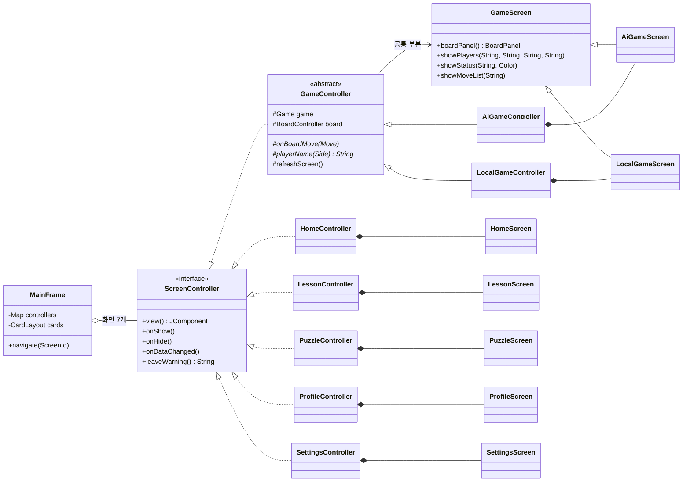
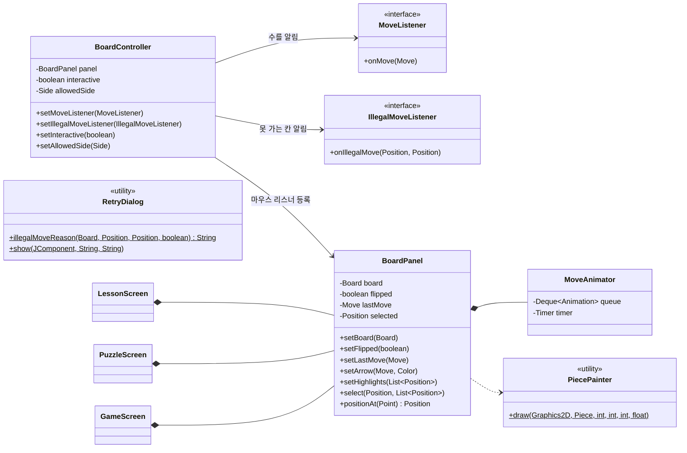

# 화면: ui 패키지

Swing과 FlatLaf로 만든 화면입니다. **MVC** 구조로 역할을 나눴습니다. 전체 그림은 [전체 구조](architecture.md)에 있습니다.

| 역할 | 패키지 | 하는 일 | 예 |
| --- | --- | --- | --- |
| View (화면) | `ui.screen` | 컴포넌트를 배치하고, 받은 값을 보여 줌. 버튼은 getter로 내줌 | `lessonScreen.showStep(...)`, `lessonScreen.hintButton()` |
| Controller | `ui.controller` | 버튼·마우스 이벤트를 받아 `ChessBackend`와 세션을 부르고, 결과를 화면에 넘김 | `LessonController.onUserMove(move)` |
| Model | `model`, `training`, `service` | 규칙, 채점, 저장 | `LessonSession.submitMove(move)` |
| 부품 | `ui.component` | 여러 화면이 같이 쓰는 그리기 부품 | `BoardPanel`, `RetryDialog` |

화면(`ui.screen`)과 부품(`ui.component`)은 `ChessBackend`를 모릅니다. 판단은 모두 컨트롤러가 합니다.

## 1. 가장 짧은 예: 설정 화면

- [`SettingsScreen`](../app/src/main/java/com/oopteama/chess/ui/screen/SettingsScreen.java) (View): 테마 칸 3개와 체크박스 4개를 배치하고, `showSettings(settings, onPickTheme)`로 현재 값을 보여 줍니다.
- [`SettingsController`](../app/src/main/java/com/oopteama/chess/ui/controller/SettingsController.java) (Controller): 화면을 만들고 체크박스에 리스너를 겁니다.

```java
public final class SettingsController implements ScreenController {

    private final ChessBackend backend;
    private final SettingsScreen screen = new SettingsScreen();

    public SettingsController(ChessBackend backend) {
        this.backend = backend;
        screen.coordsCheck().addActionListener(e ->
                backend.updateSettings(s -> s.setShowCoords(screen.coordsCheck().isSelected())));
        // ... 나머지 체크박스 3개도 같은 방식
        refresh();
    }

    private void refresh() {
        screen.showSettings(backend.settings(), this::pickTheme);
    }
    ...
}
```

체크박스를 누르면: 컨트롤러가 `backend.updateSettings(...)` 호출 → 백엔드가 저장하고 변경을 알림 → `MainFrame`이 모든 컨트롤러의 `onDataChanged()`를 부름 → 체스판이 있는 화면이 바뀐 설정으로 다시 그려집니다.

## 2. 클래스 다이어그램

### 컨트롤러와 화면



### 체스판 부품



## 3. 클래스 목록

### `ui` (3개)

| 클래스 | 하는 일 |
| --- | --- |
| `MainFrame` | 메인 창. 왼쪽 메뉴와 프로필 카드, 오른쪽은 `CardLayout`으로 화면 7개 중 하나를 보여 줌. 창을 닫을 때 저장 |
| `ScreenId` | 화면 목록 enum (홈, 레슨, 퍼즐, AI 대전, 로컬 대전, 프로필, 설정)과 메뉴 이름 |
| `Theme` | FlatLaf 어두운 테마 설치, Pretendard 글꼴, 색 상수, 카드·배지·버튼을 만드는 메서드(`card()`, `badge()`, `primaryButton()` …) |

### `ui.screen` (8개, View)

| 클래스 | 보여 주는 것 |
| --- | --- |
| `HomeScreen` | 인사말, 점수, 레슨·퍼즐·AI 전적 요약, 추천 카드, 모드 바로가기 4개 |
| `LessonScreen` | 튜토리얼·오프닝 탭, 레슨 목록(접기 가능), 체스판, 단계 안내·진행 막대·피드백, 힌트·다시 놓기·이전·다음 버튼 |
| `PuzzleScreen` | 필터, 퍼즐 목록, 체스판, 퍼즐 제목·차례·남은 수, 해설, 힌트·무르기·다시 풀기·다음 퍼즐 버튼 |
| `GameScreen` | 대국 화면의 부모: 위아래 선수 띠(잡은 기물 포함), 체스판, 상태 배너, 기보 |
| `AiGameScreen` | `GameScreen` + 난이도·진영 선택, 새 대국·힌트·무르기·보드 뒤집기·기권 버튼 |
| `LocalGameScreen` | `GameScreen` + 자동 뒤집기 표시, 무르기·보드 뒤집기·기권·새 대국 버튼 |
| `ProfileScreen` | 프로필 목록과 추가 입력칸, 현재 프로필 점수, 레슨·퍼즐 진도, 난이도별 AI 전적표, 기록 초기화 버튼 |
| `SettingsScreen` | 체스판 테마 3칸, 표시 옵션 체크박스 4개 |

### `ui.controller` (10개, Controller)

| 클래스 | 하는 일 |
| --- | --- |
| `ScreenController` | 모든 화면 컨트롤러의 인터페이스: `view()`, `onShow()`, `onHide()`, `onDataChanged()`, `leaveWarning()` |
| `BoardController` | 체스판 마우스 입력 처리 (아래 4절) |
| `HomeController` | 점수·진도 요약, 추천(안 끝낸 레슨 → 안 푼 퍼즐 → AI 대전 순서), 바로가기 버튼으로 화면 이동 |
| `LessonController` | 탭·레슨 선택, 단계 이동, 힌트, 오답 안내, 상대 응수(0.42초 뒤), 레슨 완료 기록 |
| `PuzzleController` | 필터, 퍼즐 선택, 힌트·무르기·다시 풀기·다음 퍼즐, 상대 응수(0.4초 뒤), 풀이 기록. 목록 제목은 답을 드러내지 않게 "05. 2수 안에 체크메이트"처럼 표시 |
| `GameController` | 대국 공통: `Game` 객체, 체스판 연결, 선수 띠·상태·기보 다시 그리기(`refreshScreen`), 보드 뒤집기, 진행 중 대국 이탈 경고 |
| `AiGameController` | 난이도·진영, `SwingWorker`로 AI 계산, 힌트 화살표, 무르기, 기권, 전적 기록. 화면을 떠나면 계산을 멈추고 돌아오면 이어서 둠 |
| `LocalGameController` | 두 사람 대국: 무르기, 기권, 새 대국, 차례마다 자동 뒤집기 |
| `ProfileController` | 프로필 추가·선택·삭제(마지막 하나는 삭제 불가), 기록 초기화 |
| `SettingsController` | 테마·체크박스 변경을 `backend.updateSettings(...)`로 저장 |

### `ui.component` (6개, 부품)

| 클래스 | 하는 일 |
| --- | --- |
| `BoardPanel` | 체스판 그리기 (아래 4절). 입력 처리는 하지 않음 |
| `PiecePainter` | 기물을 이미지 파일 없이 도형(`Path2D`)으로 그림 |
| `MoveAnimator` | 기물이 미끄러지는 이동 애니메이션 (아래 4절) |
| `RetryDialog` | 못 가는 칸으로 옮기려 할 때 이유를 알려 주는 안내 카드 |
| `CollapsibleList` | 접고 펼 수 있는 목록 (레슨·퍼즐 목록) |
| `RoundedPanel` | 모서리가 둥근 카드 패널 (마우스를 올리면 색이 바뀌는 버전 포함) |

## 4. 체스판: `BoardPanel` + `BoardController` + `MoveAnimator`

체스판은 **그리기(`BoardPanel`)** 와 **입력(`BoardController`)** 을 나눴습니다. 레슨·퍼즐·AI 대전·로컬 대전이 같은 두 클래스를 씁니다.

### 그리는 순서 (`BoardPanel.paintComponent`)

1. 테두리
2. 64칸: 테마 색 → 직전 수 강조 → 힌트 칸 강조 → 선택한 칸 → 체크당한 킹(빨강) → 오답 칸(잠깐 빨강)
3. 좌표 a~h, 1~8 (설정에서 켰을 때)
4. 이동 가능 칸: 빈칸은 점, 잡을 수 있는 칸은 고리 (설정에서 켰을 때)
5. 기물 (`PiecePainter`)
6. 움직이는 중인 기물 (`MoveAnimator`)
7. 힌트 화살표
8. 드래그 중인 기물 (마우스 위치)

### 마우스 입력 규칙 (`BoardController`)

| 사용자 동작 | 결과 |
| --- | --- |
| 내 기물 클릭 | 선택하고 갈 수 있는 칸을 표시 |
| 갈 수 있는 칸 클릭 | 수를 둠 → `MoveListener.onMove(move)` |
| 다른 내 기물 클릭 | 그 기물로 선택을 바꿈 (움직일 수 없는 기물이면 선택만 풀림) |
| 선택한 기물을 다시 클릭 | 선택 해제 |
| 갈 수 없는 칸 클릭 | 선택은 그대로 두고 `IllegalMoveListener`에 알림 → 레슨·퍼즐은 `RetryDialog`로 이유 안내 |
| 기물을 끌어서 놓기 | 수를 둠 (놓은 칸이 갈 수 없는 칸이면 위와 같이 안내) |
| 킹을 고른 뒤 같은 편 룩 클릭 | 캐슬링 |
| 폰이 끝 줄에 도착 | 퀸·룩·비숍·나이트 중 고르는 창 |

컨트롤러는 `setInteractive(false)`로 상대 응수를 기다리는 동안 입력을 막고, AI 대전에서는 `setAllowedSide(사람 진영)`으로 내 기물만 움직이게 합니다.

`RetryDialog.illegalMoveReason(...)`이 알려 주는 이유: 도착 칸에 아군 기물이 있음, 룩·비숍·퀸이 갈 수 없는 방향, 가는 길을 막은 기물, 그 밖에는 "e2에서 e5로는 이 국면에서 이동할 수 없어요."처럼 일반 안내(칸 이름에 맞춰 '로'·'으로'를 붙임).

### 이동 애니메이션 (`MoveAnimator`)

- `setBoard(새 국면)`을 받으면, 이전 국면에서 **합법 수 하나로** 올 수 있는 국면인지 찾습니다. 맞으면 그 기물을 0.25초 동안 미끄러지게 그립니다.
- 캐슬링은 킹과 룩이 함께 움직이고, 잡힌 기물(앙파상 포함)은 제자리에서 서서히 사라집니다.
- 드래그로 놓은 수는 이미 도착 칸에 있으므로 다시 움직이지 않습니다.
- 내 수가 끝나기 전에 상대 응수가 오면 이어서 재생합니다. 밀린 수가 더 쌓이면 마지막 수만 재생합니다.
- 무르기·새 대국처럼 한 수로 설명되지 않는 변화는 바로 표시합니다.
- 컨트롤러는 애니메이션을 신경 쓰지 않고 `setBoard()`만 부르면 됩니다.

## 5. 화면 전환 (`MainFrame`)

- 생성자에서 컨트롤러 7개를 만들어 `Map<ScreenId, ScreenController>`에 넣고, 각 컨트롤러의 `view()`를 `CardLayout`에 붙입니다.
- `navigate(ScreenId)`: 지금 화면의 `leaveWarning()`이 문구를 돌려주면(진행 중인 대국) 확인 창을 띄우고, 확인하면 지금 화면 `onHide()` → 새 화면 표시 → 새 화면 `onShow()` 순서로 부릅니다. ([흐름도](architecture.md#d-화면-전환))
- `ChessBackend`에 변경 리스너를 등록해, 데이터가 바뀌면 왼쪽 프로필 카드와 모든 화면의 `onDataChanged()`를 부릅니다.
- 창을 닫으면 진행 중인 대국을 확인한 뒤 `backend.save()`를 부르고 닫습니다.

## 6. 새 화면을 추가하는 방법

예: "통계" 화면을 추가한다면

1. `ScreenId`에 항목 추가: `STATS("통계")`
2. `ui/screen/StatsScreen.java`: `JPanel`을 상속하고, 보여 줄 값을 받는 `showXxx(...)` 메서드를 만듭니다.
3. `ui/controller/StatsController.java`: `ScreenController`를 구현합니다. 생성자에서 화면을 만들고 버튼에 리스너를 겁니다. `onShow()`에서 `backend`의 값을 읽어 화면에 넘깁니다.
4. `MainFrame` 생성자에 `register(ScreenId.STATS, new StatsController(backend));` 한 줄을 넣고, `buildSidebar()`의 메뉴 배열에 `ScreenId.STATS`를 추가합니다.

`MainFrame`은 `ScreenController` 인터페이스로만 화면을 다루므로, 새 화면을 위해 화면 전환 코드를 고칠 필요가 없습니다.

## 7. 화면 테스트

화면 테스트도 창을 띄우지 않고 실행됩니다.

| 테스트 | 확인하는 것 |
| --- | --- |
| `UiSmokeTest` | 7개 화면과 체스판 테마 3종이 오류 없이 그려지는지 |
| `BoardControllerTest` | 클릭 선택·해제, 아군 기물 클릭, 갈 수 없는 칸 클릭 후 선택 유지, 드래그 |
| `BoardPanelAnimationTest` | 클릭한 수는 미끄러지고 드래그한 수는 바로 놓임, 응수 대기열, 캐슬링·앙파상·승진 애니메이션 |
| `RetryDialogTest` | 못 가는 이유 문구 (아군 기물, 방향, 막힌 길, '로'·'으로') |
| `TrainingControllerTest` | 레슨·퍼즐에서 응수를 기다리는 중 화면을 떠났다 와도 응수가 반영되는지, 금색 위 글자 대비(4.5:1 이상), 목록 접기 버튼 모양 |
| `AiGameControllerTest` | AI가 생각하는 중 화면을 떠났다 와도 AI가 이어서 두는지, 기권 전적이 한 번만 기록되는지 |
