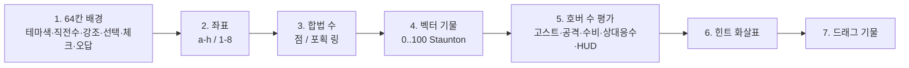

# Frontend 패키지 (`com.oopteama.chess.frontend`) & `Main`

**FlatLaf 3.7.2 (`FlatDarkLaf`)** 기반 단일 창 Swing UI입니다.  
`Main.java` + `frontend/` **12개 파일**(총 13개)로 구성되며, 모든 도메인 로직·AI 탐색·JSON 저장은 **`ChessBackend`** 퍼사드로만 위임합니다.

---

## 1. 파일 구성 요약

| 파일 | 역할 | 핵심 필드 / 메서드 |
| --- | --- | --- |
| [`Main.java`](../app/src/main/java/com/oopteama/chess/Main.java) | 조립 루트 | 다크 타이틀바 속성 설정, `new JsonStorage` → `new ChessBackend` → EDT `Theme.install()` → `MainWindow` |
| [`Theme.java`](../app/src/main/java/com/oopteama/chess/frontend/Theme.java) | FlatLaf 테마 | `FlatDarkLaf.setup()`, Pretendard 폰트, 다크 슬레이트+에메랄드 팔레트, 슬림 스크롤바, `applyButtonStyle`, `card`, `hoverCard`, `badge`, `RoundedPanel` |
| [`Screen.java`](../app/src/main/java/com/oopteama/chess/frontend/Screen.java) | 화면 계약 | `Screen.Id` enum(7개 화면) + `view()`, `onShow()`, `onHide()`, `onSettingsChanged()`, `leaveWarning()` |
| [`MainWindow.java`](../app/src/main/java/com/oopteama/chess/frontend/MainWindow.java) | 단일 창 | 다크 타이틀바, 좌측 사이드바, `CardLayout` + `Map<Screen.Id, Screen>`, 이탈 경고, 종료 시 `backend.save()` |
| [`BoardView.java`](../app/src/main/java/com/oopteama/chess/frontend/BoardView.java) | 공용 체스판 | 생성자 `(Settings, BiFunction<Board, Move, Evaluation>)` — 클릭/드래그, 벡터 기물, 승진 창, 캐슬링 룩 편의, 호버 수 평가 시각화 |
| [`HomePanel.java`](../app/src/main/java/com/oopteama/chess/frontend/HomePanel.java) | 홈 대시보드 | 프로필 요약 3카드, 미완료 레슨→퍼즐→AI 자동 추천 배너, 호버 반응 2×2 바로가기 |
| [`LessonPanel.java`](../app/src/main/java/com/oopteama/chess/frontend/LessonPanel.java) | 레슨 화면 | `[기본 튜토리얼 \| 유명 오프닝]` 탭, `backend.startLesson`/`completeLesson`, 420ms 오프닝 응수 타이머 |
| [`PuzzlePanel.java`](../app/src/main/java/com/oopteama/chess/frontend/PuzzlePanel.java) | 퍼즐 화면 | 테마 필터, 자유 메이트 남은 수 표시, `힌트`/`무르기`/`다시 풀기`/`다음 퍼즐`, `backend.startPuzzle`/`recordPuzzle` |
| [`AbstractGamePanel.java`](../app/src/main/java/com/oopteama/chess/frontend/AbstractGamePanel.java) | 대국 기반 | `backend.newGame()`, 상/하단 플레이어·잡힌 기물 바, `BoardView`, 상태 배너, 2열 SAN 기보, 이탈 경고 |
| [`AiGamePanel.java`](../app/src/main/java/com/oopteama/chess/frontend/AiGamePanel.java) | AI 대전 | 난이도/진영 설정, `SwingWorker` → `backend.chooseAiMove`/`computeHint`, `AtomicBoolean` 취소, 2수 무르기, `backend.recordAiResult` |
| [`LocalGamePanel.java`](../app/src/main/java/com/oopteama/chess/frontend/LocalGamePanel.java) | 로컬 2인 대전 | 무르기·뒤집기·기권·새 대국, `Settings.autoFlipLocal` 연동 차례별 자동 회전 |
| [`ProfilePanel.java`](../app/src/main/java/com/oopteama/chess/frontend/ProfilePanel.java) | 프로필 관리 | FlatLaf 플레이스홀더+지우기 입력창, `backend.createProfile`/`setActiveProfile`/`deleteProfile`/`clearActiveProgress`, AI 전적표 |
| [`SettingsPanel.java`](../app/src/main/java/com/oopteama/chess/frontend/SettingsPanel.java) | 설정 화면 | 보드 테마 3종 미니 체크판 카드, 5개 체크박스 → `backend.updateSettings(...)` 즉시 반영·JSON 저장 |

---

## 2. `BoardView` 렌더링 파이프라인

- **호버 프리뷰 레이어 (`drawHoverPreview`)**:
  1. 출발→도착 판정색 점선 궤적 & 반투명 고스트 기물(캐슬링 룩·승진 퀸 포함)
  2. 도착 칸 피격 시 **파랑 아군 수비선** 표시
  3. **초록/주황 내 공격·포크·체크·디스커버드 체크** 화살표 및 타깃 링
  4. **빨강 방어 이탈 아군 경고 링**
  5. **빨강/코랄 점선 상대 예상 최선 응수 화살표** (`Ke7` 탈출, 기물 반격 등)
  6. **자동 회피 1줄 평가 바** (`[메이트/좋은 수/무난/주의/위험]` + 핵심 이유 + `예상 응수 SAN`, 상단 2행 호버 시 하단 자동 이동)
