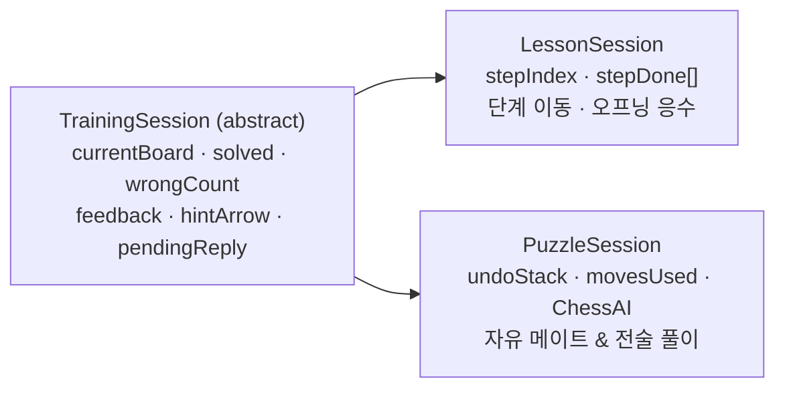

# Model 패키지 (`com.oopteama.chess.model`)

학습 콘텐츠(레슨·퍼즐), 보드 훈련 세션 상태, 사용자 프로필·설정, 파일 영속 저장을 담당합니다.  
총 **8개 파일**로 구성되며 `engine` 패키지만 참조합니다(Swing/AWT 비의존).

| 파일 | 종류 | 핵심 책임 |
| --- | --- | --- |
| [`Lesson.java`](../app/src/main/java/com/oopteama/chess/model/Lesson.java) | `record` | `Category`(튜토리얼/오프닝), `Step`(목표 매칭 및 대표 정답 계산) |
| [`Puzzle.java`](../app/src/main/java/com/oopteama/chess/model/Puzzle.java) | `record` | 퍼즐 데이터 (`mateIn > 0`이면 자유 메이트, `0`이면 전술 수순 퍼즐) |
| [`TrainingSession.java`](../app/src/main/java/com/oopteama/chess/model/TrainingSession.java) | `abstract class` | 보드 훈련 공통 상태, 3단계 피드백 사다리, 예약된 상대 응수 적용 |
| [`LessonSession.java`](../app/src/main/java/com/oopteama/chess/model/LessonSession.java) | `final class` | 튜토리얼·오프닝 단계 이동(`nextStep`/`prevStep`), 완료 추적 |
| [`PuzzleSession.java`](../app/src/main/java/com/oopteama/chess/model/PuzzleSession.java) | `final class` | 자유 메이트(AI 동적 방어) & 전술 수순 풀이, `undo()` 스냅샷 스택, 동적 힌트 |
| [`Profile.java`](../app/src/main/java/com/oopteama/chess/model/Profile.java) | `final class` | 프로필별 레슨 완료, 퍼즐 시도/정답, 난이도별 AI 전적, 종합 점수 계산 |
| [`Settings.java`](../app/src/main/java/com/oopteama/chess/model/Settings.java) | `final class` | `BoardTheme`(월넛/그린/슬레이트 RGB) 및 5개 표시·대국 옵션 |
| [`AppStore.java`](../app/src/main/java/com/oopteama/chess/model/AppStore.java) | `final class` | 번들 `.txt` 파싱, 프로필 CRUD, `~/.chessmate/` 원자적 저장 및 변경 알림 |

---

## 1. 콘텐츠 모델 (`Lesson`, `Puzzle`)

### `Lesson`
- **필드**: `id`, `Category category` (`TUTORIAL` / `OPENING`), `title`, `summary`, `Side playerSide`, `List<Step> steps`
- **중첩 `Step(Board startBoard, String goalSpec, List<Integer> hintSquares, String prompt, String successText, Move opponentReply)`**:
  - `matches(before, after, move)`: `goalSpec`이 `"any"`(아무 합법 수), `"check"`(체크), `"mate"`(체크메이트), 또는 쉼표 구분 UCI 목록(`"e2e3,e2e4"`)과 일치하는지 판정
  - `primarySolution(board)`: 힌트 화살표 및 오프닝 연쇄 국면 계산용 대표 정답 수 반환

### `Puzzle`
- **필드**: `id`, `theme`, `title`, `Board startBoard`, `List<Move> solution`, `int mateIn`, `String explanation`
- `isMatePuzzle()`: `mateIn > 0`일 때 `true` (자유 메이트 모드 활성화)

---

## 2. 보드 훈련 세션 계층 (`TrainingSession`)

### `TrainingSession` (추상 기반 클래스)
- **중첩 타입**: `Outcome` (`CORRECT_STEP`, `SOLVED`, `WRONG`), `AttemptResult(Outcome, String message, Move autoReply)`
- **공통 메서드**:
  - `applyPendingReply()`: UI가 400ms 지연 타이머 후 호출해 예약된 상대 응수를 보드에 반영
  - `applyWrongFeedback(...)`: **3단계 피드백 사다리** — 1회 오답(안내) → 2회 오답(칸 강조) → 3회 이상 오답(정답 화살표 표시)
  - `revealHint(...)`: 1차 클릭(강조 칸) → 2차 클릭(정답 화살표)
- **추상 메서드**: `submitMove(Move)`, `showHint()`, `reset()`, `orientation()`

### `LessonSession`
- **필드**: `Lesson lesson`, `boolean[] stepDone`, `int stepIndex`
- **로직**:
  - `submitMove(move)`: `step.matches(...)` 통과 시 `stepDone[stepIndex] = true`로 기록하고, 오프닝 단계에 `opponentReply`가 있으면 `pendingReply`에 예약합니다.
  - `isAllCompleted()`: 모든 단계가 완료되면 UI가 프로필에 레슨 완료를 기록합니다.

### `PuzzleSession`
- **필드**: `Puzzle puzzle`, `ChessAI ai`, `Deque<Snapshot> undoStack`, `int plyIndex`, `int movesUsed`, `boolean attempted`
- **자유 메이트 로직 (`submitFreeMate`)**:
  1. `after.isCheckmate()` → 남은 수와 무관하게 즉시 `SOLVED`
  2. 스테일메이트/기물 부족 → 무승부 경고 후 국면 유지(`WRONG`)
  3. 마지막 1수에서 메이트 실패 → 국면 유지 + 체크였다면 상대 탈출 수 SAN 안내 + 피드백 사다리
  4. 남은 수가 2수 이상이면 어떤 합법 수든 스냅샷을 쌓고 진행하며, `ai.isForcedMateAfterMove`로 강제 메이트 유지 여부를 안내하고 `ai.bestDefenseAgainstMate`로 동적 응수를 예약
- **무르기 & 동적 힌트**: `undo()`로 직전 사용자 차례 스냅샷 복구 / `showHint()`는 현재 보드에서 `ai.findMateIn(currentBoard, remainingMoves())`로 실시간 메이트 수를 계산

---

## 3. 사용자 상태 & 저장소 (`Profile`, `Settings`, `AppStore`)

### `Profile`
- **필드**: `id`, `name`, `Set<String> completedLessons`, `Map<String, int[]> puzzleStats`(`[시도, 해결]`), `Map<Difficulty, int[]> aiRecords`(`[승, 무, 패]`)
- **점수 공식 (`totalScore()`)**: `완료 레슨 × 10 + 고유 해결 퍼즐 × 5 + AI 총 승리 × 3`
- **주요 메서드**: `markLessonCompleted`, `recordPuzzle`, `puzzleAccuracyPercent`, `recordAiResult`, `clearProgress`

### `Settings`
- **중첩 `BoardTheme`**: `WALNUT`(월넛 우드), `FOREST`(토너먼트 그린), `SLATE`(모던 슬레이트) — `lightRgb()`, `darkRgb()` (AWT 비의존 RGB 정수 보관)
- **옵션 필드**: `boardTheme`, `showCoords`(true), `showLegalMoves`(true), `highlightLastMove`(true), `showMovePreview`(true), `autoFlipLocal`(false)

### `AppStore`
- **초기화 (`new AppStore(Path dataDir)`)**:
  1. 클래스패스 `/data/lessons.txt` 로드 — 오프닝의 `start` / `continue` 및 `setup=` 수순을 `Board.applyMove`로 자동 연쇄 계산
  2. 클래스패스 `/data/puzzles.txt` 로드 — `mate=N` 또는 `메이트인N` 테마에서 `mateIn` 자동 추출
  3. `dataDir/settings.txt`, `dataDir/profiles.txt` 로드 (없으면 기본 프로필 `"플레이어"` 자동 생성)
- **프로필 관리**: `profiles()`, `activeProfile()`, `setActiveProfile(id)`, `createProfile(name)`, `deleteProfile(id)` (마지막 1개 프로필 보호)
- **안전 저장**: `save()`는 임시 파일(`.tmp`)에 기록한 뒤 `ATOMIC_MOVE`로 교체해 파일 손상을 방지하며, `saveAndNotify()`가 등록된 모든 UI 리스너를 호출합니다.
