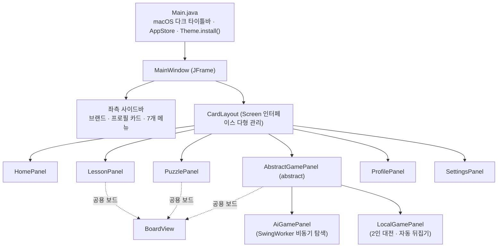
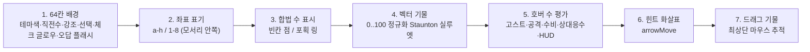

# UI 패키지 (`com.oopteama.chess.ui`) & 진입점 (`Main`)

**FlatLaf 3.7.2 (`FlatDarkLaf`)** 기반 단일 창 Swing 인터페이스입니다.  
`Main.java` + `ui/` 13개 파일(총 **14개 파일**)로 7개 화면 전체와 공용 체스판 컴포넌트를 구현합니다.

---

## 1. 화면 구성 및 컴포넌트 계층

| 파일 | 역할 | 주요 필드 / 메서드 |
| --- | --- | --- |
| [`Main.java`](../app/src/main/java/com/oopteama/chess/Main.java) | 앱 진입점 | 다크 타이틀바 시스템 속성 설정, `AppStore` 로드, EDT에서 `Theme.install()` → `MainWindow` 표시 |
| [`Theme.java`](../app/src/main/java/com/oopteama/chess/ui/Theme.java) | 테마 & 팩토리 | `FlatDarkLaf.setup()`, Pretendard 폰트, 다크 슬레이트+에메랄드 팔레트, 슬림 스크롤바, `applyButtonStyle`, `card`, `hoverCard`, `badge`, `RoundedPanel` |
| [`Screen.java`](../app/src/main/java/com/oopteama/chess/ui/Screen.java) / [`ScreenId.java`](../app/src/main/java/com/oopteama/chess/ui/ScreenId.java) | 화면 계약 | `view()`, `onShow()`, `onHide()`, `onSettingsChanged()`, `leaveWarning()` / 7개 화면 enum |
| [`MainWindow.java`](../app/src/main/java/com/oopteama/chess/ui/MainWindow.java) | 메인 윈도우 | 사이드바 네비게이션, `Map<ScreenId, Screen>`, `navigate(ScreenId)`, 이탈 확인, 창 종료 시 `store.save()` |
| [`BoardView.java`](../app/src/main/java/com/oopteama/chess/ui/BoardView.java) | 공용 체스판 | 클릭·드래그 이동, 벡터 기물 렌더링, 프로모션 다이얼로그, 캐슬링 룩 클릭 편의, **호버 수 평가 시각화** |
| [`HomePanel.java`](../app/src/main/java/com/oopteama/chess/ui/HomePanel.java) | 홈 대시보드 | 프로필 요약 카드 3종, 미완료 레슨→퍼즐→AI 순 자동 추천 배너, 2×2 바로가기 카드 |
| [`LessonPanel.java`](../app/src/main/java/com/oopteama/chess/ui/LessonPanel.java) | 레슨 화면 | `[기본 튜토리얼 \| 유명 오프닝]` 탭, 완료 목록, 단계 진행 바, 420ms 오프닝 자동 응수 타이머 |
| [`PuzzlePanel.java`](../app/src/main/java/com/oopteama/chess/ui/PuzzlePanel.java) | 퍼즐 화면 | 테마 필터 콤보, 자유 메이트 남은 수 표시, `힌트`/`무르기`/`다시 풀기`/`다음 퍼즐`, 400ms 응수 타이머 |
| [`AbstractGamePanel.java`](../app/src/main/java/com/oopteama/chess/ui/AbstractGamePanel.java) | 대국 기반 클래스 | 상/하단 플레이어·잡힌 기물 바, `BoardView`, 상태 배너, 2열 SAN 기보 목록, 진행 중 이탈 경고 |
| [`AiGamePanel.java`](../app/src/main/java/com/oopteama/chess/ui/AiGamePanel.java) | AI 대전 | 난이도/진영 설정, `SwingWorker` 비동기 `ChessAI.chooseMove`/`hint`, `AtomicBoolean` 취소, 2수 무르기, 전적 자동 기록 |
| [`LocalGamePanel.java`](../app/src/main/java/com/oopteama/chess/ui/LocalGamePanel.java) | 로컬 2인 대전 | 무르기·뒤집기·기권·새 대국, `Settings.autoFlipLocal` 연동 차례별 자동 회전 |
| [`ProfilePanel.java`](../app/src/main/java/com/oopteama/chess/ui/ProfilePanel.java) | 프로필 관리 | 프로필 추가(플레이스홀더+지우기 버튼)·전환·삭제, 튜토리얼/오프닝/퍼즐 통계, 4난이도 AI 전적표, 기록 초기화 |
| [`SettingsPanel.java`](../app/src/main/java/com/oopteama/chess/ui/SettingsPanel.java) | 설정 화면 | 3종 보드 테마 미니 체크판 미리보기 카드, 5개 체크박스 토글(변경 즉시 `saveAndNotify()`) |

---

## 2. `BoardView` 렌더링 파이프라인 상세

`BoardView.paintComponent(Graphics)`는 매 프레임 아래 **7개 레이어**를 순서대로 그립니다.

### 주요 내부 구현 포인트
- **OS 무관 선명한 벡터 기물 (`drawPiece`, `pieceSilhouette`)**: 유니코드 폰트 깨짐 문제를 없애기 위해 `0..100` 정규화 좌표계 `Path2D`/`Ellipse2D`로 6종 Staunton 기물을 직접 그려 모든 해상도에서 균일하게 렌더링합니다.
- **호버 프리뷰 최적화 (`handleHover`, `drawHoverPreview`)**:
  - `hoverSquare`가 바뀔 때만 동작하며, 국면별 `cachedBaselineScore`(1회)와 수별 `evalCache`(`Map<Move, MoveEvaluation>`)로 중복 연산을 제거합니다.
  - **시각 레이어**: ① 출발→도착 판정색 점선 궤적 ② 도착 칸 고스트 기물(캐슬링 룩·승진 퀸 포함) ③ 피격 시 파랑 아군 수비선 ④ 초록/주황 내 공격·포크·체크·디스커버드 체크 화살표 ⑤ 빨강 방어 이탈 아군 경고 링 ⑥ 빨강/코랄 점선 **상대 예상 최선 응수 화살표** ⑦ 자동 회피 평가 바(상단 2행 호버 시 하단 자동 이동).
- **입력 편의**: 클릭 이동과 드래그 앤 드롭을 모두 지원하며, 킹 선택 후 아군 룩을 클릭하거나 호버해도 캐슬링(`findMatchingMoves`)으로 인식합니다.
